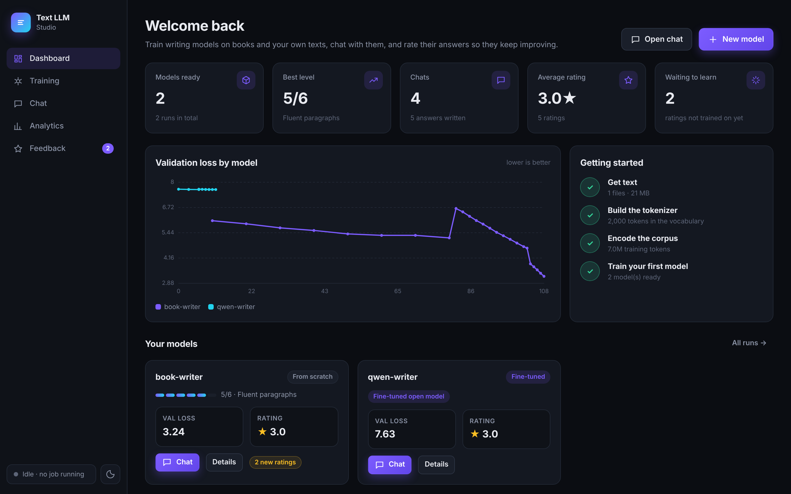
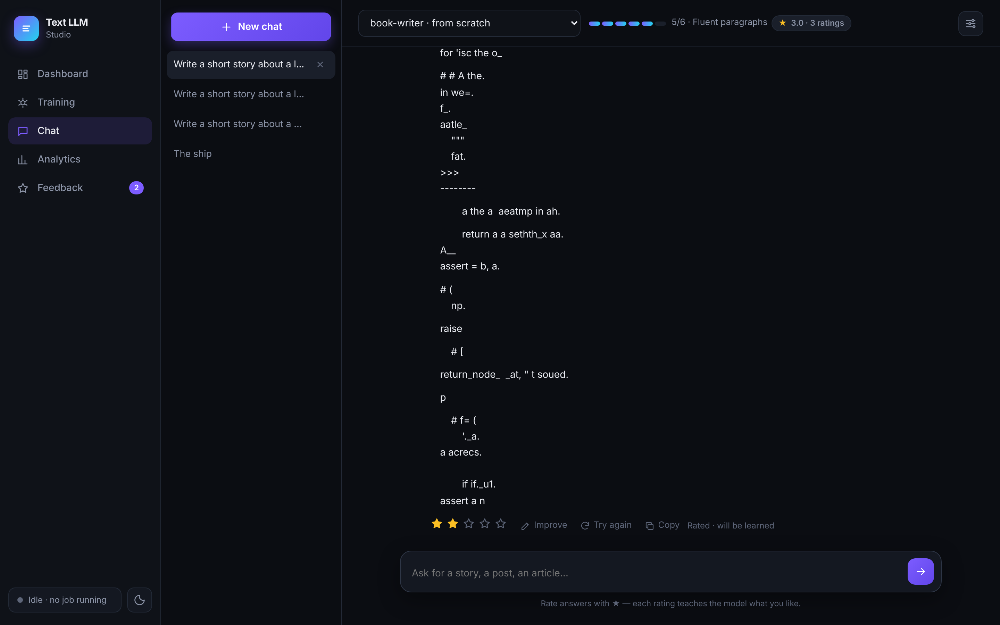
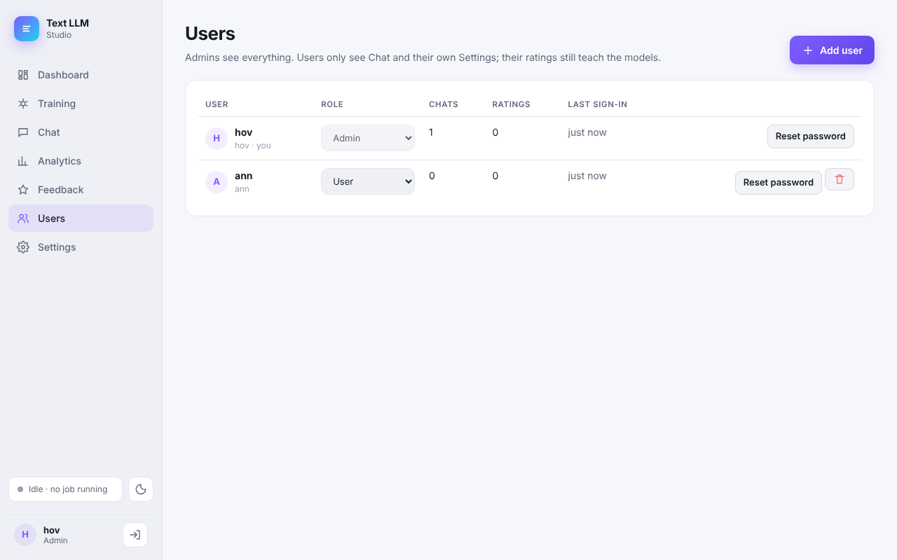
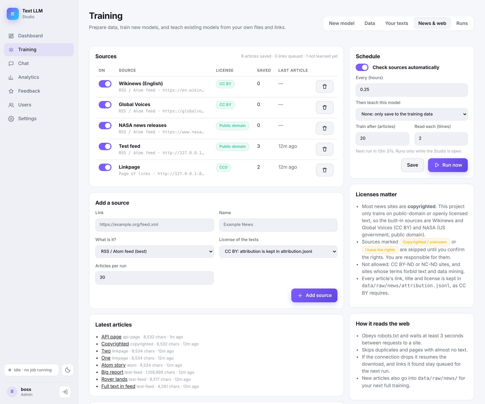

# Text LLM

A writing model for social posts, stories and essays: a small open model fine-tuned on rights-cleared writing data and run fast on CPU, plus a from-scratch GPT trained on public-domain books (Project Gutenberg) and openly licensed web text (FineWeb-Edu).

The fine-tuned path is the one to use for writing; see [Phase 2](#phase-2-a-writing-model-for-posts-stories-and-essays-lora).

## Quick start: one command
```bash
./run.sh             # macOS / Linux
run.bat              # Windows (or double-click it)
python run.py        # any OS
```
The first run creates a virtual environment in `.venv`, installs the packages, and creates the data folders. Then it starts the Studio and opens http://127.0.0.1:7860 in your browser. Later runs skip the install unless `requirements.txt` or the PyTorch build changed. Stop it with Ctrl+C.

Options: `--port 8000`, `--host 0.0.0.0` (other devices on your network), `--no-browser`, `--reinstall`, `--gpu` / `--cpu` / `--torch-index cu128` (pick the PyTorch build, see below), `--no-venv` (use your current Python). If the port is busy it uses the next free one.

## Using your GPU (laptop or desktop)
Training and chat use the GPU automatically when there is one; nothing to set in the Studio. The Dashboard shows which device is in use.

| GPU | What happens |
|---|---|
| **NVIDIA** (GeForce GTX 10xx and newer, RTX, laptop GPUs) | `run.bat` / `run.sh` finds it with `nvidia-smi` and installs the CUDA build of PyTorch (CUDA 13 or 12.8 depending on the driver, 11.8 for very old drivers). If you installed the CPU build earlier, the next run swaps it (a ~2.5 GB download). RTX 30xx and newer train in bf16, older cards in fp16 with loss scaling. |
| **Apple Silicon Mac** | Uses the Apple GPU (MPS) with the normal install. |
| **Intel Arc** | `run.py --torch-index xpu` (experimental). |
| **AMD Radeon / Intel integrated** | No PyTorch GPU support on Windows, so it trains on the CPU. On Linux, AMD works with `--torch-index rocm6.2`. |

If the GPU isn't used: update the NVIDIA driver (https://www.nvidia.com/Download/index.aspx), then `run.bat --reinstall`. On laptops with two GPUs, plug in the charger and set Windows *Settings → Display → Graphics* to "High performance" for Python. To force the CPU, use `run.bat --cpu` or set `TEXTLLM_DEVICE=cpu`; every script also takes `--device cuda|mps|cpu`.

**What fits in laptop GPU memory (VRAM):**
- 4 GB: from scratch with the `cpu` size (fast, minutes per 1,000 steps); LoRA on `Qwen/Qwen3-0.6B` with batch 2, seq 512.
- 6–8 GB: from scratch with `small` (110M) using batch 4, grad-accum 32; LoRA on Qwen3-0.6B batch 8, or Qwen3-1.7B batch 2.
- 12 GB+: `small` with batch 8–16; LoRA on Qwen3-1.7B batch 8.
If you see "CUDA out of memory", halve the batch and double the gradient accumulation (same tokens per step).

Runs move freely between GPU and CPU PCs: checkpoints load on the CPU first and then move to whatever device the new PC has, so **Resume** and **Import** work in both directions.

## Manual setup
```bash
pip install -r requirements.txt
python app.py        # open http://127.0.0.1:7860
```

## Text LLM Studio (web app)
A step-by-step user manual with screenshots of every page: [docs/Studio-Manual.pdf](docs/Studio-Manual.pdf) (source: [docs/manual.md](docs/manual.md); rebuild with `docs/manual-build/build.sh`, needs pandoc and Playwright).

| Page | What it does |
|---|---|
| **Dashboard** | KPIs, learning curves, setup checklist and your models at a glance |
| **Training** | New model wizard (from scratch or fine-tune), data preparation, *Your texts* (upload PDF/DOC/DOCX/TXT/MD/HTML, links, folders → learn → delete), and all runs with live progress, ETA, loss chart, level and log |
| **Chat** | Conversations with any trained model, a format picker (posts, stories, essays) with a small form, streaming answers, automatic format checks, ★ ratings, *Improve* (write the answer you wanted), *Try again* |
| **Analytics** | Writing-quality scores per format, blind A/B votes, promotion of the default model, ratings per format, validation loss, ratings per day, leaderboard, job history |
| **Feedback** | Every rated answer, "Train now" per model, and automatic learning after N new ratings |
| **Users** | Add people, set their role (admin or user), reset passwords, remove accounts |
| **Settings** | Your display name, password and chat defaults (model, creativity, length). Admins also pick the device: automatic, CPU or a specific GPU |

Every script option you would normally need is in the Studio too: download mode, retries and workers for a flaky connection (Training → Data → *Downloading*), your own posts and synthetic posts for the writing instructions (step 4), warmup / weight decay / torch.compile and "continue from a fine-tuned model" (New model → *Advanced*), the GGUF quality level and evaluation subsets (open a run), and the ratings-training passes, learning rate and DPO strength (Feedback → *Training options*). Only the installer flags of `run.py` (`--gpu`, `--cpu`, `--torch-index`, `--reinstall`) stay on the command line, because they run before the Studio starts.




### Accounts and roles
Everyone signs in. The first time you open the app it asks you to create the **admin** account.
- **Admin:** every page above, including Users.
- **User:** only **Chat** (their own conversations) and **Settings**. Their ratings and corrections still teach the models.

Admins add people on the Users page, or from the command line:
```bash
python -m studio.auth add alice --admin   # asks for a password
python -m studio.auth add bob             # regular user
python -m studio.auth passwd bob          # new password
python -m studio.auth role bob admin      # promote
python -m studio.auth list
```
Passwords are stored as salted PBKDF2 hashes in `runs/studio.db`; the server checks the role on every API call, not only in the page. Chats from before accounts existed belong to the first admin.



### How ratings train the model
`feedback_train.py` (run from the Feedback page, or automatically after 10 new ratings by default):
- **Fine-tuned models:** answers rated 4–5★ and your corrections are trained on directly. A liked or corrected answer paired with a disliked answer to the same prompt is trained with a DPO preference loss. A disliked answer with nothing better is pushed below its previous likelihood.
- **From-scratch models:** these only continue text, so they re-read prompts with their liked answers.
- **No double training:** feedback that has been used is marked "learned" and isn't trained on again.
- **Storage:** chats and ratings are stored in `runs/studio.db` (SQLite).

## Train on your own files and links
```bash
# Teach an existing model: extract → train → delete the extracted/downloaded text
python learn.py --run runs/scratch-cpu --files book.pdf essay.docx notes.md ~/MyBooks \
    --urls https://www.gutenberg.org/cache/epub/1342/pg1342.txt https://example.com/article --passes 3
#   --delete-originals also removes the files you passed in

# Or just add them to the corpus (data/raw/custom/) for the next full training
python data/ingest.py --files book.pdf ~/MyBooks --urls https://example.com/article
```
- **Supported inputs:** .pdf (text-based PDFs only; scanned PDFs need OCR first, for example `ocrmypdf`), .docx, .doc (needs LibreOffice or antiword), .txt, .md, .html, and web links to articles, online PDFs or plain-text books. Folders are searched recursively.
- **Forgetting:** for from-scratch models, learning mixes in an equal amount of the original corpus so the model doesn't forget the rest (`--mix`).
- **Copyright:** only use texts you have the right to use.

## Read news and web pages on a schedule

Training → **News & web** (admins only) reads RSS/Atom feeds and web pages every few hours, saves new
articles to `data/raw/news/<source>/`, and can teach a chosen model the new articles once enough
have arrived (default 20). From the command line:

```bash
python data/crawl.py                         # read every enabled source once
python data/crawl.py --learn runs/my-model   # ...then teach that model the new articles
python data/crawl.py --list
python data/crawl.py --add https://example.org/feed.xml --license cc-by --name "Example"
```



- **Licenses.** Most news is copyrighted, and this project only trains on public-domain or openly
  licensed text. The built-in sources are Wikinews and Global Voices (CC BY) and NASA news releases
  (US government, public domain). A source marked "copyrighted / unknown" or "I have the rights" is
  skipped until an admin confirms they have permission. CC BY-ND / NC-ND sites aren't allowed.
  Every article's link, title and license goes to `data/raw/news/attribution.jsonl`.
- **Polite.** Obeys robots.txt (and Crawl-delay), waits at least 3 s between requests to a site,
  uses conditional GETs for feeds, and skips duplicates and pages with under 600 characters of text.
- **Resumable.** URL state lives in `runs/_crawler/crawl.db`, so a stopped run continues next time.
  Downloads resume from a `.part` file with HTTP Range after a dropped connection; failed pages are
  retried on the next two runs. If training fails, the articles stay in `runs/_crawler/pending.txt`.
- The schedule runs while the Studio is open. With the Studio closed, use Windows Task Scheduler
  or cron to run `python data/crawl.py --learn runs/my-model`.

### Public posts from Mastodon and Bluesky

The same page can add a **Mastodon** or **Bluesky** source. Posts are read through each network's
public, documented API without logging in (nothing is scraped from web pages):

| Network | Link to add | Reads |
|---|---|---|
| Mastodon | `https://<server>/tags/poetry` | posts with a hashtag |
| | `https://<server>/@user` | one account's public posts |
| | `https://<server>/public/local` | the server's local timeline |
| Bluesky | `https://bsky.app/profile/<handle>` | one account's posts |
| | `https://bsky.app/profile/<handle>/feed/<name>` | a custom feed |
| | `https://bsky.app/hashtag/writing`, `https://bsky.app/search?q=...` | hashtag or search |

```bash
python data/crawl.py --add https://bsky.app/hashtag/shortstory --kind bluesky --license cc-stated --terms-ok
```

- **Rights.** A public post is still its author's copyright. With the license **Only openly licensed
  authors** (`cc-stated`) a post is kept only when its author's profile says CC0, CC BY or CC BY-SA
  (NC/ND refused); that license is recorded per post. "I have the rights" fits your own account.
  Every social source also needs the admin to confirm that the server's terms allow it.
  mastodon.social and mastodon.online forbid collecting posts for LLM training, so they are refused.
- **Opt-outs and filters.** Skipped: non-public posts, replies, boosts/reposts, content warnings,
  accounts with Mastodon's `noindex`, Bluesky's `!no-unauthenticated`, or #nobot / #noai /
  #notraining / #nosearch in the profile, and posts under 120 characters.
- **Personal data.** The training text never names the author: @mentions become `@someone`, links
  are removed, e-mail addresses and phone numbers are replaced. The post link and author handle are
  kept only in `attribution.jsonl`, because CC BY requires attribution.
- **Not offered:** Reddit (its Data API terms forbid training AI models on its content), X/Twitter
  (paid API, terms forbid training), Facebook, Instagram, Threads, LinkedIn and TikTok (no public
  API for this, terms forbid scraping). Adding one of their links explains why.

## Write in your own style (style profiles)

Training → **Your style** learns how one account writes (length, tone, vocabulary, emoji and hashtag
habits) from its posts, then Chat writes new posts in that voice with the format
**Write like a style profile**.

1. **Import posts** into a profile. Sources:
   - your **X archive** (Settings → Download an archive of your data), **Facebook** or **Instagram**
     "Download your information" export (Format: JSON), or **Mastodon** archive. Upload the .zip; it is
     read in place and deleted right after the import;
   - a **Facebook Page** or **Instagram professional account you manage**, through the Meta Graph API
     with a Page access token (used once, not stored);
   - a **Mastodon or Bluesky profile**: yours, or one whose author states CC0 / CC BY / CC BY-SA.
2. **Train**: a LoRA fine-tune (`runs/style-<profile>`), from the base model or on top of an
   existing fine-tuned run so it keeps its writing skills. At least 30 posts.
3. **Chat**: pick the `style-<profile>` model; give it a topic.

```bash
python data/own_posts.py --profile me --name "Me" --x-archive twitter.zip --i-own-these
```

Reposts, replies and photo-only posts are dropped; links, @mentions, e-mails and phone numbers are
removed. Other people's Facebook, Instagram, Threads or X accounts can't be imported: Meta has no API
for them and forbids scraping, and X's developer terms forbid training models on X content.

## CPU-only quick path (recommended for a laptop or desktop)
CPU training is about 100× slower than a GPU, so this path uses a 14M-parameter model, an 8k vocabulary, and roughly 3,000 books.
The `--gutenberg-max 3000` flag takes the first 3,000 English books in the catalog (about 1 GB, roughly 300M tokens).
I measured about 3,000 tokens/s on 4 CPU cores, so an 8-core machine might do around 6,000 (an estimate, not measured).
At those speeds, 20,000 steps (≈330M tokens) take about 1–2 days on 4 cores, or less on more cores.
```bash
python data/build_corpus.py --gutenberg-max 3000 --fineweb-gb 0.3
python tokenizer/train_tokenizer.py --raw data/raw --vocab 8192 --out tokenizer/bpe.json
python tokenizer/train_tokenizer.py --encode --raw data/raw --tok tokenizer/bpe.json --bin data/bin
python train.py --preset cpu --vocab 8192 --batch 16 --grad-accum 4 --max-steps 20000 \
    --warmup 500 --eval-every 250 --lr 1e-3
# stop any time with Ctrl+C; continue later with the same command plus --resume
python generate.py --prompt "The old captain looked at the sea and" --tokens 300
```
**If the download keeps disconnecting** (`WinError 10054`, "Server disconnected"): just run the same
`build_corpus.py` command again. Every source continues from its own `data/raw/<source>/progress.json`
(saved after every small chunk; FineWeb-Edu shards from older versions are picked up too).
Each request is retried up to `--retries 30` times with backoff of up to 2 minutes. On a very unstable connection, add
`--hf-mode download` to save whole parquet files (resumable) to `data/cache/` first.

### More book sources
All of these are off by default (0 = skip). Pick them in the Studio under Training → Data → "More book sources", or on the command line:

| Flag | Source | License |
|---|---|---|
| `--gutenberg-method harvest` | Gutenberg's official robot harvest (zip files) instead of the mirror in catalog order | public domain (US) |
| `--pg19-books N` | [PG-19](https://huggingface.co/datasets/deepmind/pg19), 28,752 Gutenberg books from before 1919, read from DeepMind's public bucket. Books Gutenberg already saved are skipped. | Apache 2.0 |
| `--standard-ebooks N` | [Standard Ebooks](https://standardebooks.org), ~1,400 proofread classics. Read from their GitHub repos, or from the Patrons feed if `STANDARD_EBOOKS_EMAIL` is set. `GITHUB_TOKEN` avoids GitHub's hourly limit. | CC0 |
| `--common-corpus-gb G` | [Common Corpus](https://huggingface.co/datasets/PleIAs/common_corpus), only the "Open Culture" part (public-domain books and newspapers, OCR). `--common-corpus-lang en` or `all`. | public domain |
| `--archive-books N` | Internet Archive scans published before 1931 (americana, toronto, europeanlibraries collections; never the lending library). OCR text, keep it a small share. | public domain (US) |
| `--cosmopedia-gb G` | [Cosmopedia](https://huggingface.co/datasets/HuggingFaceTB/cosmopedia) synthetic text by Mixtral. `--cosmopedia-subsets stories,wikihow,...` (the GB are split evenly, one folder per subset) | Apache 2.0 |
| `--wikipedia-gb G` | [Wikipedia](https://huggingface.co/datasets/wikimedia/wikipedia) (2023-11-01 dump). `--wikipedia-lang en` or any language code (`de`, `fr`, `hy`, ...); one folder per language. | CC BY-SA 4.0 |
| `--common-pile-gb G` | [Common Pile v0.1](https://huggingface.co/collections/common-pile/common-pile-v01-filtered-data) (EleutherAI, openly licensed only). `--common-pile-subsets` picks parts, default `news,public_domain_review,pressbooks,cccc`; also `doab`, `wikimedia` (Wikibooks/Wikinews/Wikiquote/Wikisource/Wikiversity/Wikivoyage), `youtube`, `foodista`, `stackexchange`, `library_of_congress`, `pre_1929_books`, `oercommons`, `libretexts`, `uk_hansard`. The GB are shared in order, so a small part leaves its unused share to the next. Rows marked NC or ND are dropped. | CC BY / BY-SA / PD |

```bash
python data/build_corpus.py --gutenberg-max 3000 --pg19-books 3000 --standard-ebooks 500 \
    --cosmopedia-gb 0.3 --common-pile-gb 0.5 --fineweb-gb 0.3
```
Left out on purpose: **BookCorpus** and **BookCorpusOpen** (copyrighted Smashwords books copied without permission),
**The Pile** (contains Books3, taken down after a DMCA notice), **RedPajama's book subset** (PG-19 plus Books3),
and **Open Library dumps** (catalog metadata only, no book text). **Dolma's book subset** and
`open-thoughts/gutenberg` are Project Gutenberg again, so they would only duplicate the books above.

It saves a checkpoint every 250 steps (about 20 minutes on 4 cores, sooner on more), so you can try `generate.py` while it trains.
Expect grammatical, book-flavoured prose that drifts after a few sentences. It won't produce coherent stories or follow instructions.

## Train on several PCs at once (cluster, over the internet)

Several computers (CPU or GPU, any mix, at home or across the internet) can train one from-scratch
model together. In the Studio: **Training → Cluster → Start a cluster on this PC** on the PC with
the prepared data, then on every other PC either **Join a cluster** in its Studio or:

```
run.bat --join http://ADDRESS:7861 --secret SECRET      # ./run.sh on Linux/macOS; installs everything first
```

It uses local training with periodic averaging (DiLoCo-style), not per-step DDP, because internet
latency would make synchronous training crawl:

* Training runs in rounds (5 min by default). Each PC trains on its own share of the text for the
  round's time with its own AdamW, as many steps as it manages (a GPU does more than a CPU).
* Each PC uploads how far its weights moved (bf16). The coordinator averages the moves weighted by
  tokens and takes one Nesterov-momentum outer step (lr 0.7, momentum 0.9). Workers then download
  only the bf16 change. Traffic per PC per round ≈ one model copy each way: 28 MB for the CPU size,
  220 MB for Small.
* PCs can join or leave at any time; a slow PC never holds the others up; a stopped coordinator
  resumes with `--resume` and the workers reconnect by themselves. Workers without data download
  their share of `train.bin` once (resumable).
* Expect about 0.6–0.9× each extra PC's own speed (four similar PCs ≈ 3× one PC).
* Over the internet use Tailscale/ZeroTier (simplest and encrypted) or forward TCP 7861. Every request
  needs the shared secret; weights are loaded with `torch.load(weights_only=True)`, never as pickled code.

The result is a normal run (`runs/<name>/ckpt.pt`): chat, export or keep training it with `train.py --resume`.
From the command line: `python cluster.py coordinator --out runs/cluster-writer --preset cpu --vocab 8192 --local-worker`
and `python cluster.py worker --join http://ADDRESS:7861 --secret SECRET` (see `python cluster.py worker -h`).
Cluster mode covers from-scratch models; LoRA fine-tuning still runs on one PC.

## Move a model to another PC and keep training
Both kinds of model can be stopped on one PC and continued on another (CPU or GPU, Windows or Linux).
A checkpoint holds the weights, the optimizer state, the step and LR schedule, the random state of
the batch sampler, and the training settings, so training continues where it stopped.

**In the Studio:** open the model (Training → Runs), press **Stop** if it is training, then **Export**
(for a from-scratch model, OK = include the training data). On the new PC, run `run.bat` once, go to Training → Runs →
**Import a model (.zip)**, open the model and press **Resume**.

**From the command line:**
```bash
# old PC (training stopped)
python transfer.py export --run runs/my-model --with-data     # -> my-model.textllm.zip
# new PC, inside its own copy of this repo
python transfer.py import my-model.textllm.zip                 # -> runs/my-model, prints the resume command
python train.py --out runs/my-model --resume ...               # or finetune/finetune_lora.py ... --resume
```
- **What is in the zip:** the whole `runs/<name>/` folder (`ckpt.pt`, or `adapter/` + `train_state.pt` +
  `examples.pt` for a fine-tune, plus `meta.json`, `train_cmd.json`, charts, eval history, the GGUF copy)
  and, for a from-scratch model, its tokenizer. A fine-tune always carries its exact examples.
  `--with-data` adds a from-scratch model's `train.bin`/`val.bin`; on import they go to
  `runs/<name>/data/bin/`, so they never overwrite or mix with the new PC's own `data/bin/`.
- **Without `--with-data`:** a from-scratch model needs `data/bin/train.bin` + `val.bin` on the new PC,
  encoded with the **same** tokenizer. Copy `data/bin/` over, or encode new text with
  `--tok runs/my-model/tokenizer.json`. Never train a new tokenizer for a moved model.
- **Fine-tunes:** the base model (e.g. `Qwen/Qwen3-0.6B`) is not packed; the new PC downloads it once.
- **Saves:** from scratch saves at every evaluation (every 1/80 of the run in the Studio), a fine-tune
  every 1/10 of the run. Work after the last save is redone. Saves are written to a temp file first, so
  a crash or power cut never leaves a broken checkpoint.
- **Copying by hand works too:** copy `runs/<name>/` (and `data/bin/`) to the same place in the other
  copy of the repo, then resume. Older runs stored the tokenizer's full path, so also copy
  `tokenizer/bpe.json` there as `runs/<name>/tokenizer.json`.

## Pipeline (GPU)
```bash
# 1. Download the corpus (~10 GB of Gutenberg + N GB of FineWeb-Edu)
python data/build_corpus.py --gutenberg-max 70000 --fineweb-gb 20

# 2. Train a 32k BPE tokenizer, then encode everything into uint16 token files
python tokenizer/train_tokenizer.py --raw data/raw --vocab 32000 --out tokenizer/bpe.json
python tokenizer/train_tokenizer.py --encode --raw data/raw --tok tokenizer/bpe.json --bin data/bin

# 3. Pretrain (one 24 GB GPU, ~110M params)
python train.py --preset small --compile
#    or multi-GPU
torchrun --nproc_per_node=8 train.py --preset 1b --batch 8 --grad-accum 4 --compile
#    resume after a stop
python train.py --preset small --resume

# 4. Write something
python generate.py --prompt "Chapter One. The storm came in from the sea" --tokens 500
```

## Model presets (model/gpt.py)
| preset | params | context | rough hardware |
|---|---|---|---|
| tiny | ~4M | 256 | CPU, for testing only |
| small | ~110M | 1024 | 1× 24 GB GPU, 2–4 days for ~5B tokens |
| medium | ~340M | 1024 | 1–2× A100, about a week |
| 1b | ~1.3B | 2048 | 8× A100, several days |

The architecture is a pre-norm decoder with RMSNorm, rotary position embeddings, SwiGLU MLP, and tied embeddings.
Checkpoints are written to `checkpoints/ckpt.pt` at every evaluation.
The default `--max-steps 100000` with batch 16×8×1024 is about 13B tokens, so lower it if you want a shorter run.

Writing with a from-scratch model uses a key/value cache, so each new token runs only that token through the
model (about 5–6× faster than recomputing the whole text). When the text outgrows the model's context, the
last three quarters of the window are kept and generation continues. On CPUs with native bf16
(AVX-512 BF16 or AMX, e.g. recent Xeons and AMD Zen 4/5) `train.py` runs matmuls in bf16 with fp32 weights,
about 1.7× faster; set `TEXTLLM_BF16=0` to turn it off.

## Tests

    pip install pytest
    python -m pytest

They run offline on a CPU in well under a minute, using tiny models made on the spot (no downloads).

## Phase 2: a writing model for posts, stories and essays (LoRA)
The recommended path on CPU: fine-tune a small Apache 2.0 instruct model on writing instructions, run it as a
4-bit GGUF, write with per-format templates, and only promote a new model when it measurably wins.

**1. Build the writing instructions** (Training → Data → step 4, or):
```bash
python data/build_instructions.py --from-studio --hf-sets
python data/build_instructions.py --my-posts my_posts.txt          # your own posts, separated by --- lines
# optional, on a free Colab/Kaggle GPU (or a 1.7-4B GGUF on CPU, ~50 per format):
python data/build_instructions.py --synth-model Qwen/Qwen3-8B --synth-per-format 300 --backtranslate Qwen/Qwen3-8B
```
| Source | License |
|---|---|
| Gutenberg books tagged "Short stories" / "Essays", split into single pieces with a matching request | public domain (US) |
| Your liked and corrected chat answers, your own posts | yours |
| Posts written by an Apache 2.0 model (best of 3 by the automatic checks) | Apache 2.0 output |
| OpenAssistant oasst2 / Databricks Dolly 15k, capped at ~12% | Apache 2.0 / CC BY-SA 3.0 (keep attribution) |

Each example records its `source` and `license`; counts are in `data/instructions/stats.json`.
Sets scraped from Reddit or social platforms are not used.

**2. Fine-tune** (Training → New model → Fine-tune, or):
```bash
python finetune/finetune_lora.py --base Qwen/Qwen3-0.6B --out runs/my-social-writer \
    --instructions data/instructions/train.jsonl --book-share 0.2 --lora-r 8 --epochs 2 --gguf
```
- Base models in the wizard: Qwen3 0.6B (CPU default) and 1.7B, Qwen3.5 0.8B / 2B (newest, multimodal checkpoints, marked
  experimental), SmolLM3 3B, and the previous Qwen2.5 0.5B. All Apache 2.0. Thinking mode is always off for writing.
- Book continuation is capped at `--book-share` (20%) of the mix, so the model learns formats and keeps some style.
- CPU speed-ups: threads = physical cores, bfloat16 autocast on CPUs with AVX-512 BF16 or AMX, length-bucketed
  batches (short posts aren't padded to essay length), and a disk cache of the tokenized examples.
- On a free GPU use `--base Qwen/Qwen3-1.7B --batch 8 --seq 1024 --lora-r 16`, then copy the run folder back.

**3. Fast CPU chat.** `--gguf` (on by default in the wizard) merges the adapter, converts it with llama.cpp's
`convert_hf_to_gguf.py` and quantizes it to Q4_K_M with llama-cpp-python. Chat and evaluation use
`runs/<name>/model-Q4_K_M.gguf` whenever it is newer than the adapter; feedback training rebuilds it.
Run it by hand with `python export_gguf.py --run runs/my-social-writer` (or the run's "Make fast CPU copy" button).
`run.py` installs a prebuilt llama-cpp-python once; without it everything still works through PyTorch, just slower.
The converter comes from a llama.cpp checkout (`--llama-cpp PATH`, `$LLAMA_CPP_DIR`, or a shallow clone into `tools/`).

**4. Formats in Chat.** Pick X post, Threads post, LinkedIn post, Instagram caption, Facebook post, Short story or
Essay. Each has a system prompt, a small form (tone, audience, takeaway, hashtags, length…) and its own sampling.
Posts are checked (length limit, hashtags, hook, closing question) and regenerated up to 3 times if they fail;
stories and essays are planned first (outline, shown above the answer) and then written from the plan.
Limits and prompts live in `writing/formats.json`, so a platform change is a one-line edit.

**5. Evaluate and promote.**
```bash
python evaluate.py --run runs/my-social-writer            # 60 fixed prompts (writing/eval_prompts.jsonl)
python evaluate.py --run runs/my-social-writer --quick    # 8 prompts, a few minutes
python evaluate.py --pairs runs/my-social-writer runs/old-writer [--judge Qwen/Qwen3-4B]
```
Analytics shows the scores per format, a blind A/B voting card, ratings per format, and a **Make default** button.
A model becomes the default only if it wins at least 55% of at least 10 blind votes and no format's checks drop by more
than 5 points (`studio/gate.py`). Automatic feedback training runs a quick check before and after and restores the
previous adapter if any format drops by more than 5 points (switch: Feedback → Quality gate).
