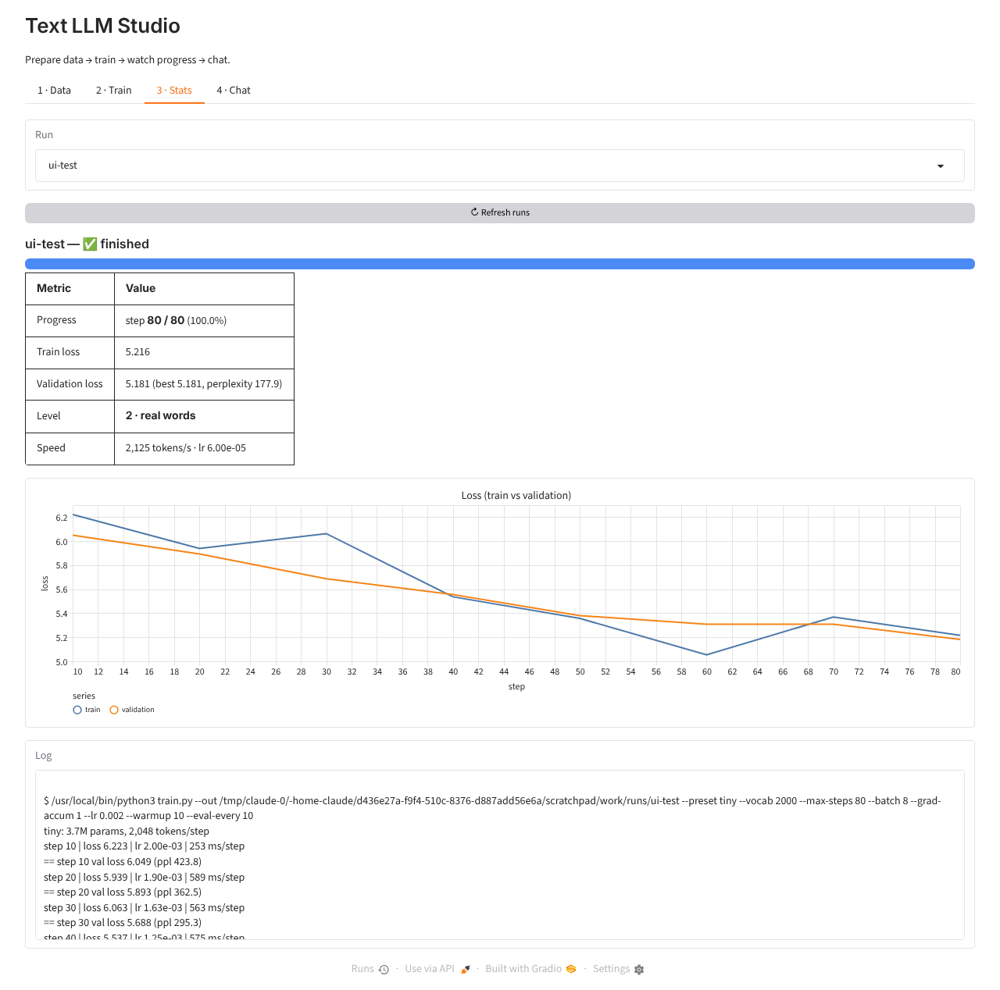

# Text LLM

A small GPT-style model trained on public-domain books (Project Gutenberg) and openly licensed web text (FineWeb-Edu).

## Setup
```bash
pip install -r requirements.txt
```

## Easiest: the web app
```bash
python app.py        # open http://127.0.0.1:7860
```
The app has five tabs:
1. **Data:** download books, train the tokenizer and encode the corpus, with live status.
2. **Your texts:** upload PDF, DOC, DOCX, TXT, MD or HTML files, paste links, or point at a folder.
   *Teach a trained model now* downloads and extracts the texts, trains the model on them, then deletes them.
   *Add to training data* keeps them in `data/raw/custom/` for the next full training.
3. **Train:** choose "From scratch" or "Fine-tune open model", set the size and steps, then Start or Stop. You can resume a stopped from-scratch run.
4. **Stats:** a live progress bar with ETA, train and validation loss chart, perplexity, speed, and a rough quality **level**:
   1 random letters, 2 real words, 3 short phrases, 4 grammatical sentences, 5 fluent paragraphs, 6 stays on topic.
5. **Chat:** pick any trained model and send requests. A fine-tuned model follows instructions; a from-scratch model continues your text.

Every run lives in `runs/<name>/` (log.txt, metrics.jsonl, checkpoint or LoRA adapter).



## Train on your own files and links
```bash
# Teach an existing model: extract → train → delete the extracted/downloaded text
python learn.py --run runs/scratch-cpu --files book.pdf essay.docx notes.md ~/MyBooks \
    --urls https://www.gutenberg.org/cache/epub/1342/pg1342.txt https://example.com/article --passes 3
#   --delete-originals also removes the files you passed in

# Or just add them to the corpus (data/raw/custom/) for the next full training
python data/ingest.py --files book.pdf ~/MyBooks --urls https://example.com/article
```
- **Supported inputs:** .pdf (text-based PDFs only; scanned PDFs need OCR first, for example `ocrmypdf`), .docx, .doc (needs LibreOffice or antiword), .txt, .md, .html, and web links to articles, online PDFs or plain-text books. Folders are searched recursively.
- **Forgetting:** for from-scratch models, learning mixes in an equal amount of the original corpus so the model doesn't forget the rest (`--mix`).
- **Copyright:** only use texts you have the right to use.

## CPU-only quick path (recommended for a laptop or desktop)
CPU training is about 100× slower than a GPU, so this path uses a 14M-parameter model, an 8k vocabulary, and roughly 3,000 books.
The `--gutenberg-max 3000` flag takes the first 3,000 English books in the catalog (about 1 GB, roughly 300M tokens).
I measured about 3,000 tokens/s on 4 CPU cores, so an 8-core machine might do around 6,000 (an estimate, not measured).
At those speeds, 20,000 steps (≈330M tokens) take about 1–2 days on 4 cores, or less on more cores.
```bash
python data/build_corpus.py --gutenberg-max 3000 --fineweb-gb 0.3
python tokenizer/train_tokenizer.py --raw data/raw --vocab 8192 --out tokenizer/bpe.json
python tokenizer/train_tokenizer.py --encode --raw data/raw --tok tokenizer/bpe.json --bin data/bin
python train.py --preset cpu --vocab 8192 --batch 16 --grad-accum 4 --max-steps 20000 \
    --warmup 500 --eval-every 250 --lr 1e-3
# stop any time with Ctrl+C; continue later with the same command plus --resume
python generate.py --prompt "The old captain looked at the sea and" --tokens 300
```
It saves a checkpoint every 250 steps (about 20 minutes on 4 cores, sooner on more), so you can try `generate.py` while it trains.
Expect grammatical, book-flavoured prose that drifts after a few sentences. It won't produce coherent stories or follow instructions.

## Pipeline (GPU)
```bash
# 1. Download the corpus (~10 GB of Gutenberg + N GB of FineWeb-Edu)
python data/build_corpus.py --gutenberg-max 70000 --fineweb-gb 20

# 2. Train a 32k BPE tokenizer, then encode everything into uint16 token files
python tokenizer/train_tokenizer.py --raw data/raw --vocab 32000 --out tokenizer/bpe.json
python tokenizer/train_tokenizer.py --encode --raw data/raw --tok tokenizer/bpe.json --bin data/bin

# 3. Pretrain (one 24 GB GPU, ~110M params)
python train.py --preset small --compile
#    or multi-GPU
torchrun --nproc_per_node=8 train.py --preset 1b --batch 8 --grad-accum 4 --compile
#    resume after a stop
python train.py --preset small --resume

# 4. Write something
python generate.py --prompt "Chapter One. The storm came in from the sea" --tokens 500
```

## Model presets (model/gpt.py)
| preset | params | context | rough hardware |
|---|---|---|---|
| tiny | ~4M | 256 | CPU, for testing only |
| small | ~110M | 1024 | 1× 24 GB GPU, 2–4 days for ~5B tokens |
| medium | ~340M | 1024 | 1–2× A100, about a week |
| 1b | ~1.3B | 2048 | 8× A100, several days |

The architecture is a pre-norm decoder with RMSNorm, rotary position embeddings, SwiGLU MLP, and tied embeddings.
Checkpoints are written to `checkpoints/ckpt.pt` at every evaluation.
The default `--max-steps 100000` with batch 16×8×1024 is about 13B tokens, so lower it if you want a shorter run.

## Phase 2: fine-tune an open model (LoRA)
`finetune/finetune_lora.py` teaches `Qwen/Qwen2.5-0.5B-Instruct` (Apache-2.0) to continue book passages in chat form.
That gives it a literary style while it keeps following requests like "write a story about…" or "write a post about…".
You can add your own examples with `--extra my_examples.jsonl`, one `{"prompt": "...", "response": "..."}` per line.
```bash
python finetune/finetune_lora.py --raw data/raw/gutenberg --out runs/finetune-qwen --max-steps 300
```
On CPU this is slow. My rough guess is about a minute per step, so 300 steps is several hours, but I haven't measured it.
On a free Colab or Kaggle GPU, use `--base Qwen/Qwen2.5-1.5B-Instruct --batch 8 --seq 1024` for better writing.
