# About this manual

Text LLM Studio is the web app of this project. It runs on your own computer and lets you collect rights-cleared text, train writing models (from scratch or by fine-tuning an open model), chat with them, rate their answers and teach them from those ratings.

This manual walks through every page of the Studio in the order you would normally use them.

> **About the screenshots.** They were taken from a real Studio, but with demo data: a few MB of generated stand-in text, a 4M-parameter "tiny" model trained for a few minutes, and a tiny stand-in base model for the fine-tuned examples (shown as `models/tiny-base` instead of a Qwen model). Numbers such as loss, vocabulary size and scores therefore look different from a real run, and the example answers in Chat and Analytics were written by hand for illustration. Every button, field and page is exactly as the app shows them.

**Contents**

1. Installing and starting the Studio
2. Accounts and roles
3. Dashboard
4. Training: New model
5. Training: Data
6. Training: Your texts
7. Training: News & web
8. Training: Your style
9. Training: Corpus
10. Training: Cluster (several PCs train one model)
11. Training: Runs, run details, Resume, Export and Import
12. Chat
13. Analytics
14. Feedback
15. Users
16. Settings and hardware
17. Command-line equivalents
18. Troubleshooting

# 1. Installing and starting the Studio

You need Python 3.10 or newer. Get the project with `git clone https://github.com/hovchik/textllm` (or download the zip from GitHub) and start it with one command:

| System | Command |
|---|---|
| Windows | double-click **run.bat** (or run `run.bat` in a terminal) |
| macOS / Linux | `./run.sh` |
| Any | `python run.py` |

The first start creates a virtual environment in `.venv`, installs the packages and creates the data folders. This takes a few minutes. Then the Studio starts and your browser opens **http://127.0.0.1:7860**. Later starts are quick: packages are only reinstalled when `requirements.txt` or the PyTorch build changed. Stop the Studio with **Ctrl+C** in its window.

Useful options for `run.bat` / `run.sh` / `run.py`:

| Option | What it does |
|---|---|
| `--port 8000` | use another port (if 7860 is busy the next free port is used anyway) |
| `--host 0.0.0.0` | let other devices on your network open the Studio |
| `--no-browser` | don't open the browser |
| `--gpu` / `--cpu` | force the CUDA (NVIDIA) or the CPU build of PyTorch |
| `--torch-index cu128` | pick an exact PyTorch build (also `xpu`, `rocm6.2`) |
| `--reinstall` | reinstall all packages |
| `--no-venv` | use your current Python instead of `.venv` |

**GPU.** With an NVIDIA graphics card, `run.bat` finds it with `nvidia-smi` and installs the CUDA build of PyTorch automatically. Apple Silicon Macs use the Apple GPU. Everything else trains on the CPU. Which device is used is shown on the Dashboard and can be changed under Settings → Hardware (section 16).

These installer flags are the only options that are not in the Studio itself, because they run before the Studio starts. Every other script option has a control in the web app.

# 2. Accounts and roles

The very first time you open the Studio it asks you to create the **admin** account. Choose a username and a password of at least 6 characters; the display name is optional.

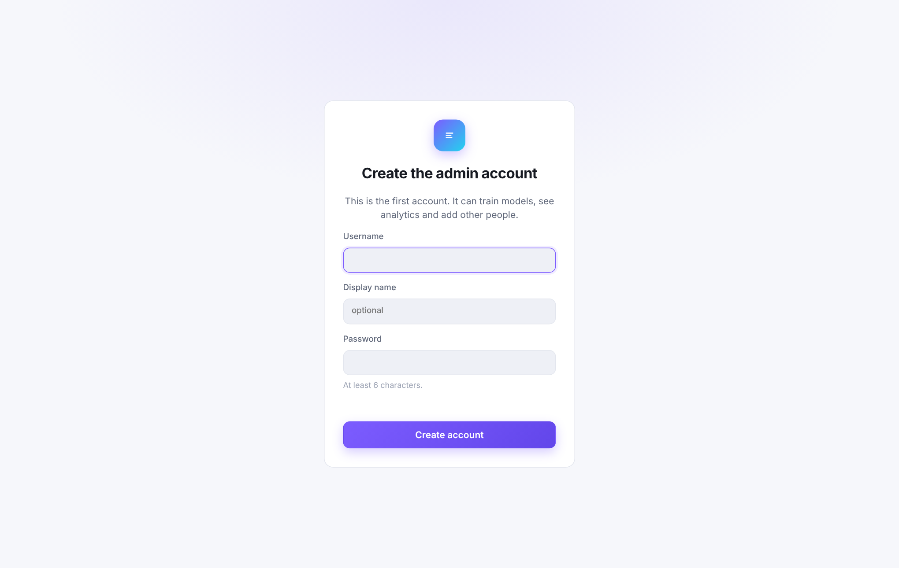

After that everyone signs in with their own account. There are two roles:

| Role | Can see |
|---|---|
| **Admin** | every page: Dashboard, Training, Chat, Analytics, Feedback, Users, Settings (including Hardware) |
| **User** | only **Chat** (their own conversations) and **Settings** (name, password, chat defaults) |

A regular user's ratings and corrections still teach the models. The server checks the role on every request, so hiding a page is not the only protection. Passwords are stored as salted hashes in `runs/studio.db`.

This is what a regular user sees: only Chat and Settings in the sidebar.

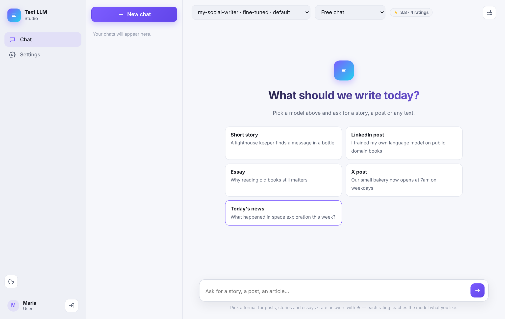

The bottom of the sidebar shows who is signed in, a **sign out** button, a **theme** button (light / dark) and, for admins, the **job pill**. The job pill says "Idle · no job running" or names the job that is running; click it to jump to Training → Runs.

# 3. Dashboard

The Dashboard is the home page for admins.

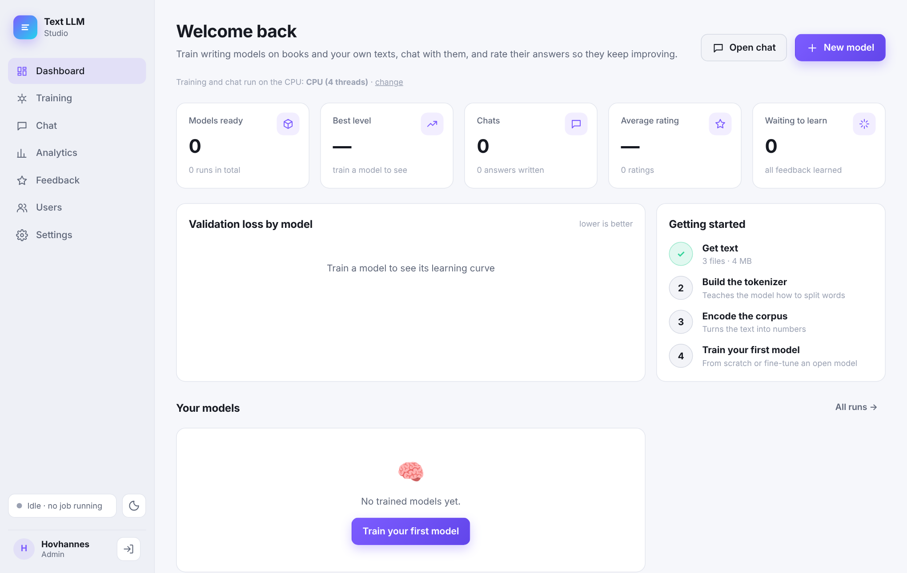

On a fresh install the **Getting started** list shows what to do next: get text, build the tokenizer, encode the corpus, train your first model. Each step is a link to the right page and gets a green check mark when it is done.

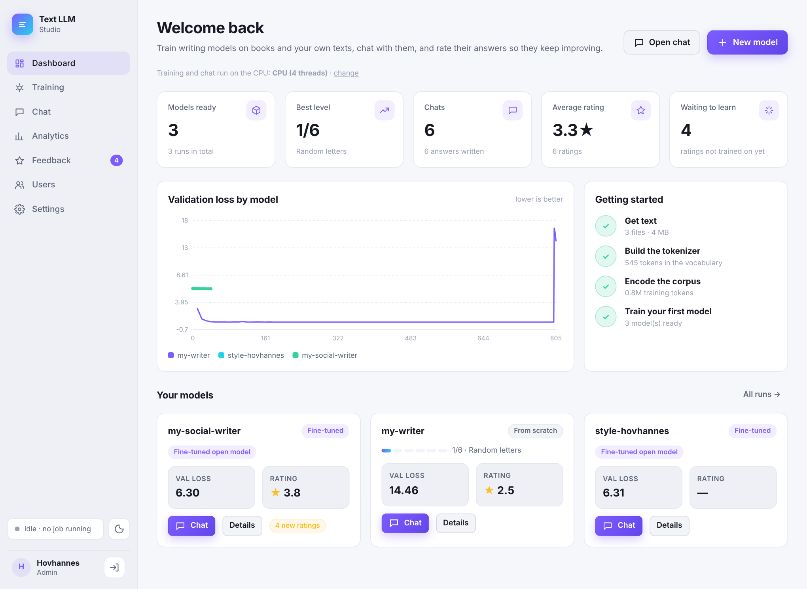

Once you have models it shows:

- **Device line:** whether training and chat run on the GPU or the CPU, with a **change** link to Settings.
- **KPIs:** models ready, best level reached by a from-scratch model (1/6 to 6/6), number of chats and answers, average star rating, and ratings that are **waiting to learn**.
- **Validation loss by model:** learning curves of all models (lower is better).
- **Your models:** a card per model with its type (From scratch / Fine-tuned), level, validation loss and average rating, plus **Chat** and **Details** buttons. A yellow "N new ratings" tag means the model has feedback it hasn't learned yet.
- **Live card:** while a job runs, a card with a progress ring, step, ETA, loss and a **Stop** button appears at the top.
- **Open chat** and **New model** buttons at the top right.

> **Note.** For a from-scratch model the "validation loss" after **Your texts** or feedback learning measures how well it knows the *new* text, so the number and the curve jump up at that point. That is expected, not a broken model.

# 4. Training: New model

**Training** has seven tabs: New model, Data, Your texts, News & web, Your style, Corpus and Runs. **New model** is a three-step wizard.

## 4.1 Train from scratch

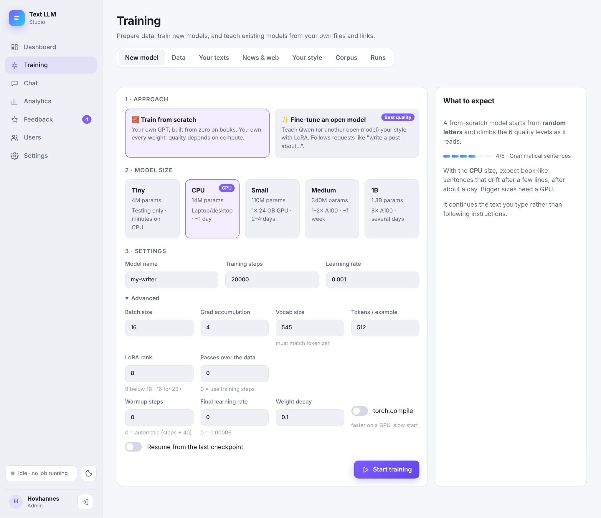

1. **Approach:** *Train from scratch* builds your own GPT from zero. You own every weight; quality depends on how much compute you give it. It continues text rather than following instructions.
2. **Model size:**

   | Size | Parameters | Hardware |
   |---|---|---|
   | Tiny | 4M | testing only, minutes on CPU |
   | CPU | 14M | laptop or desktop, about a day |
   | Small | 110M | one 24 GB GPU, 2–4 days |
   | Medium | 340M | 1–2 × A100, about a week |
   | 1B | 1.3B | 8 × A100, several days |

3. **Settings:** model name, training steps (default 20,000) and learning rate (0.001).

**Advanced** (click to open): batch size, gradient accumulation, vocabulary size (must match the tokenizer), tokens per example, warmup steps (0 = steps ÷ 40), final learning rate, weight decay, **torch.compile** (faster on a GPU, slow start) and **Resume from the last checkpoint**.

Before training from scratch you must run Data steps 1–3 (section 5). The right-hand card "What to expect" explains the six quality levels: random letters → … → grammatical sentences → stays on topic.

## 4.2 Fine-tune an open model (LoRA)

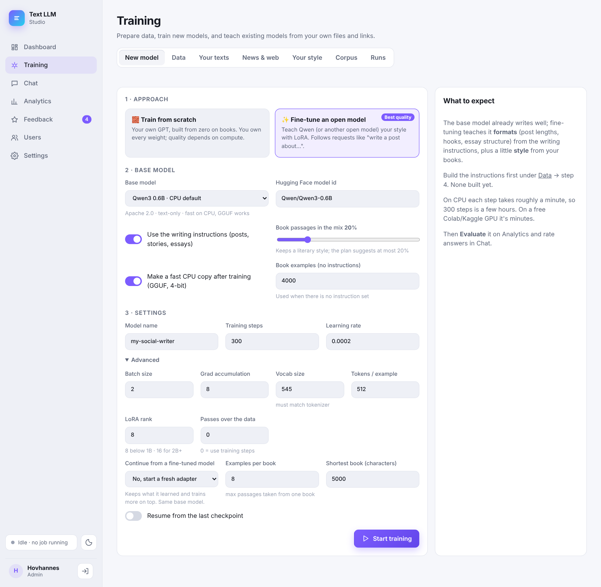

Choose **Fine-tune an open model** to teach an existing open model (Apache 2.0) your formats and style with LoRA. This gives the best writing quality and the model follows requests like "write a post about…".

- **Base model:** Qwen3 0.6B (CPU default), Qwen3 1.7B (better writing), Qwen3.5 0.8B / 2B (newest, experimental), SmolLM3 3B, Qwen2.5 0.5B, or **Other** to type any Hugging Face model id.
- **Use the writing instructions (posts, stories, essays):** trains on the set built in Data → step 4.
- **Book passages in the mix:** share of book continuation (default 20%) so the model keeps a literary style.
- **Make a fast CPU copy after training (GGUF, 4-bit):** makes chat much faster on a CPU.
- **Book examples:** used only when there is no instruction set.

Defaults switch to 300 steps, learning rate 0.0002, batch 2, accumulation 8. Under **Advanced** you also get **LoRA rank** (8 below 1B, 16 for 2B+), **passes over the data** (0 = use training steps), **Continue from a fine-tuned model** (keeps what it learned, same base model), **examples per book** and **shortest book**.

On a CPU each fine-tuning step takes about a minute, so 300 steps is a few hours. Press **Start training**; the Studio opens the run's details so you can watch it.

# 5. Training: Data

The Data tab prepares the training corpus in four steps. Run them in order with each step's **Run** button. A step with a green check is done; the log of the running step is shown at the bottom of the page.

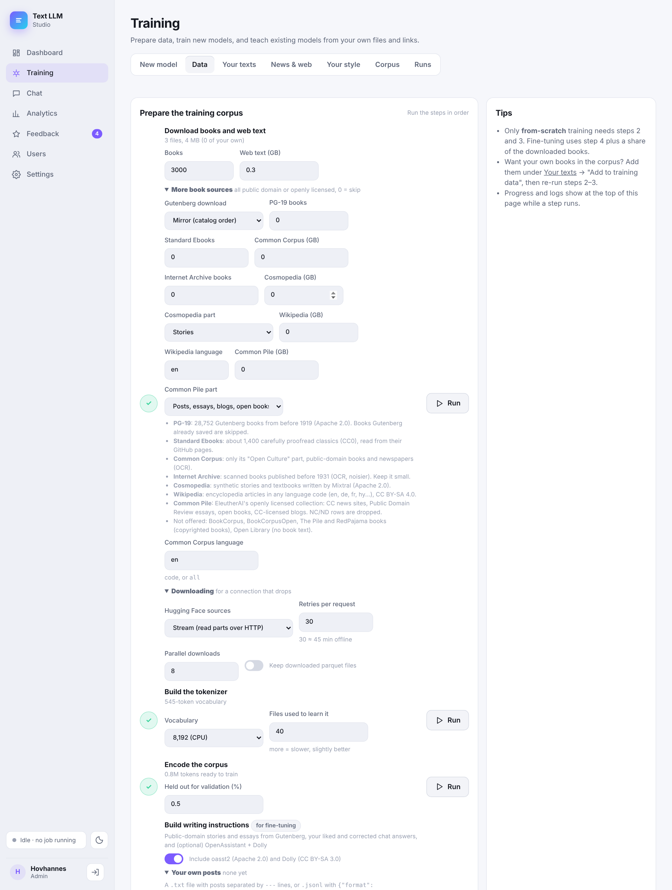

**Step 1 · Download books and web text.** *Books* is how many Project Gutenberg books to download (default 3,000); *Web text (GB)* is how much FineWeb-Edu (openly licensed educational web text) to add.

- **More book sources** (all public domain or openly licensed; 0 = skip): Gutenberg download method (mirror or official robot harvest), PG-19 books, Standard Ebooks, Common Corpus (GB and language), Internet Archive books from before 1931, Cosmopedia (GB and part: stories, how-to guides, textbooks…), Wikipedia (GB and language code, e.g. `en`, `hy`), Common Pile (GB and part: posts and essays, CC news, CC blogs, open books, Wikibooks/Wikivoyage, spoken style, public-domain OCR books).
- **Downloading** (for a connection that drops): stream Hugging Face sources or download whole files first (resumable), retries per request (30 ≈ 45 minutes offline), parallel downloads, keep downloaded parquet files.
- Not offered on purpose: BookCorpus, The Pile, RedPajama books (copyrighted books) and Open Library (no book text).

If the download stops, press **Run** again: every source continues where it stopped.

**Step 2 · Build the tokenizer.** Learns the word pieces the model reads and writes. Vocabulary 8,192 for CPU models or 32,000 for GPU models; *Files used to learn it* (more is slower and slightly better).

**Step 3 · Encode the corpus.** Turns all text into token files for fast training. *Held out for validation* is the share kept aside to measure validation loss (default 0.5%).

Steps 2 and 3 are only needed for from-scratch training. After you add or delete text, run **step 3 (Encode) only** if you want to keep training an existing model: a model must always read text encoded with the tokenizer it was trained with, and a new tokenizer gives the same token numbers different meanings without any error. Build a new tokenizer (step 2, then step 3) only before training a **new** model from scratch.

**Step 4 · Build writing instructions** (for fine-tuning). Makes examples of posts, stories and essays from public-domain Gutenberg stories and essays and your liked and corrected chat answers, plus optionally OpenAssistant (Apache 2.0) and Dolly (CC BY-SA 3.0).

- **Your own posts:** upload `.txt` files (posts separated by `---` lines) or `.jsonl` files (`{"format": "linkedin_post", "text": "..."}`). Only your own posts.
- **More options:** number of Gutenberg stories and essays, books to read per kind, random seed, a **model that writes example posts** (synthetic posts per format; use a GPU) and a **model that writes the requests** (back-translation).

# 6. Training: Your texts

Teach a model your own books, articles and notes, or add them to the corpus.

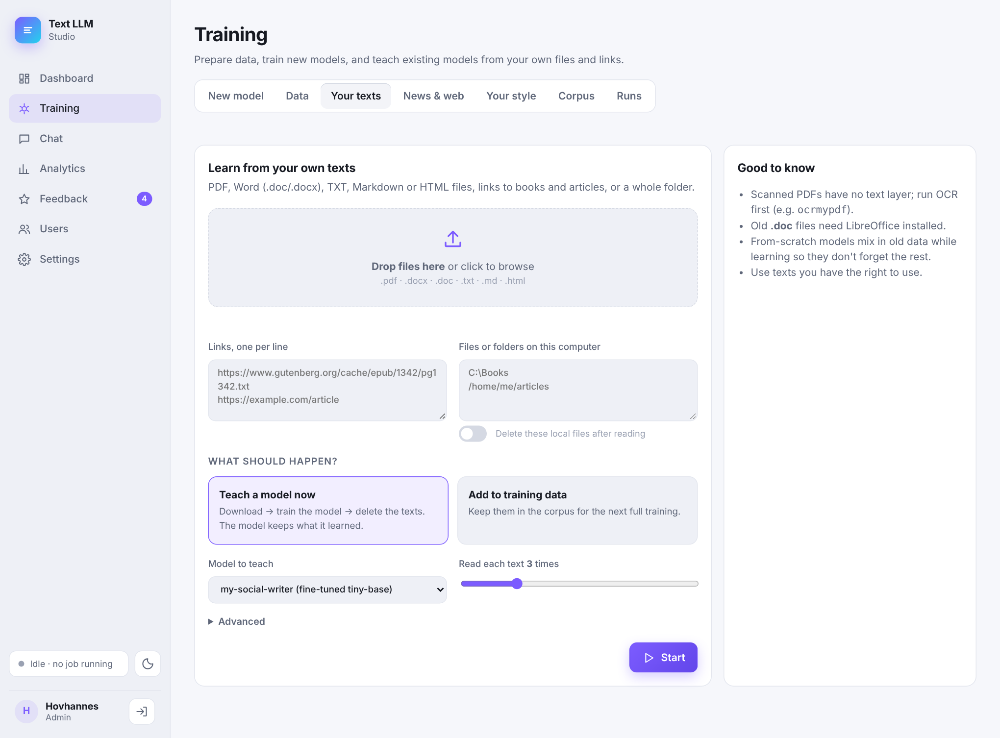

1. **Add texts:** drop files onto the box (or click to browse): PDF, Word (.docx and .doc), TXT, Markdown and HTML. You can also paste **links**, one per line (articles, online PDFs, plain-text books), and **files or folders on this computer** (folders are searched recursively). Tick *Delete these local files after reading* if you want them removed.
2. **What should happen?**
   - **Teach a model now:** download → train the chosen model → delete the extracted text. The model keeps what it learned. Choose the **model to teach** and how many times to **read each text** (1–10, default 3). Under **Advanced**: how much old text is mixed in per new token (from-scratch models only, so they don't forget; default 1) and the learning rate (0 = automatic).
   - **Add to training data:** keeps them in `data/raw/custom/` for the next full training. Then run Data step 3 (Encode); also step 2 only if you will train a new model from scratch (see section 5).
3. Press **Start**.

Good to know: scanned PDFs have no text layer, so run OCR first (e.g. `ocrmypdf`); old `.doc` files need LibreOffice; only use texts you have the right to use.

# 7. Training: News & web

Reads RSS/Atom feeds, web pages and public social posts on a schedule, saves new articles to `data/raw/news/<source>/`, and can teach a model the new articles once enough have arrived.

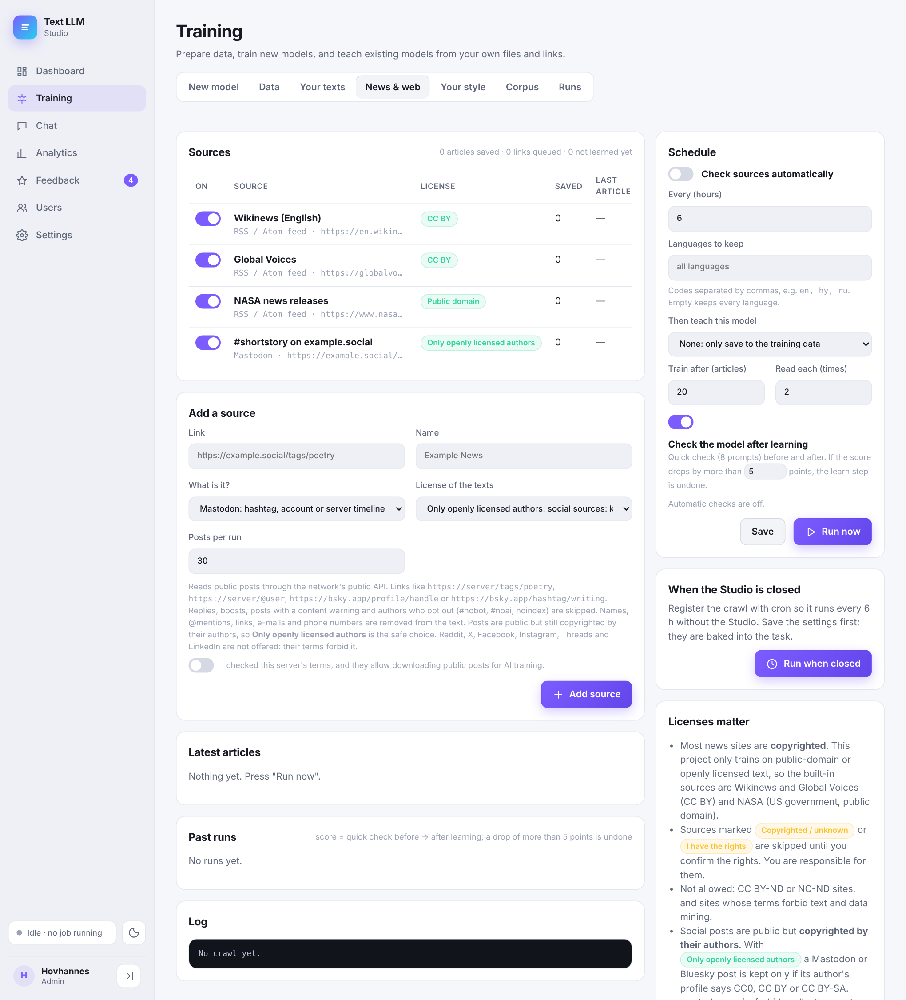

**Sources.** The table lists every source with an on/off switch, its kind and link, its license, how many articles were saved, when the last one arrived, and a delete button. The built-in sources are Wikinews and Global Voices (CC BY) and NASA news releases (public domain).

**Add a source.** Enter the link and a name, then pick:

- **What is it?** RSS / Atom feed (best), page of links (reads the articles it links to), single page, **Mastodon** (hashtag `https://server/tags/poetry`, account `https://server/@user` or local timeline `https://server/public/local`) or **Bluesky** (profile, custom feed, hashtag or search).
- **License of the texts.** Sources marked *copyrighted / unknown* or *I have the rights* are skipped until you tick the box that you own them or have permission. CC BY-ND and NC-ND sites are not allowed.
- **Articles (or posts) per run.**

For Mastodon and Bluesky you must also confirm that the server's terms allow downloading public posts for AI training. With the license **Only openly licensed authors** a post is kept only if its author's profile says CC0, CC BY or CC BY-SA. Replies, boosts, posts with a content warning and authors who opt out (#nobot, #noai, noindex) are skipped; names, @mentions, links, e-mails and phone numbers are removed. mastodon.social and mastodon.online forbid collecting posts for AI training, so they are refused. Reddit, X, Facebook, Instagram, Threads, LinkedIn and TikTok are not offered because their terms forbid it.

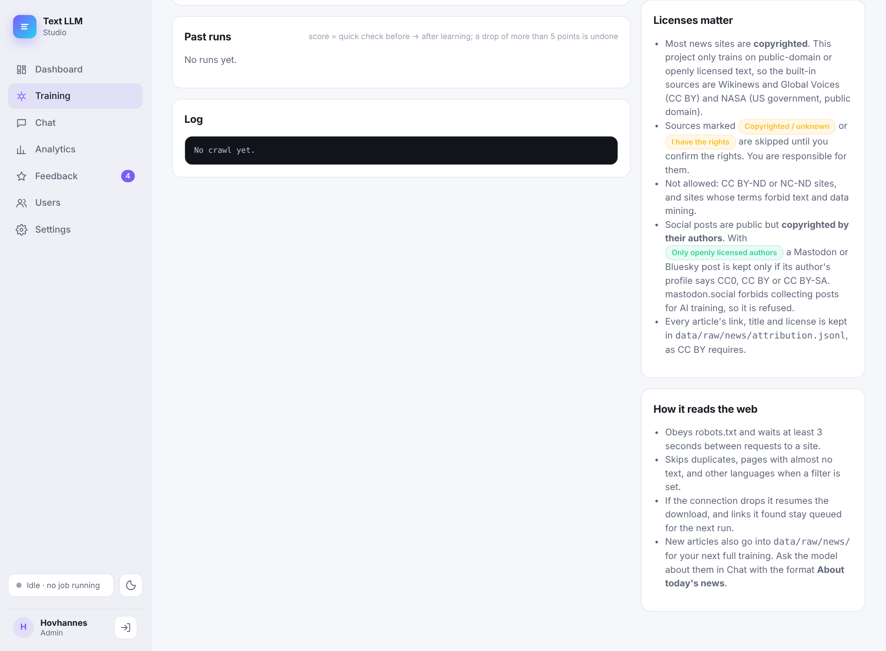

**Schedule** (right column):

- **Check sources automatically** every N hours.
- **Languages to keep:** codes like `en, hy, ru`; empty keeps every language.
- **Then teach this model:** pick a model, or *None* to only save the articles. **Train after** N articles, **read each** N times.
- **Check the model after learning:** runs a quick check (8 prompts) before and after; if the score drops by more than the given number of points, the learning is undone.
- **Save** stores the settings; **Run now** reads all sources once.
- **When the Studio is closed:** **Run when closed** registers the crawl with Windows Task Scheduler (or cron on Linux/macOS) so it runs even when the Studio is not open. **Remove** / **Update** change that task.

Below the sources you see the **latest articles** (with language), **past runs** (articles added, failed, and whether learning was kept or undone with the score before → after) and the **log**.

The crawler obeys robots.txt, waits at least 3 seconds between requests to a site, skips duplicates and near-empty pages, and resumes after a dropped connection. Every article's link, title and license is written to `data/raw/news/attribution.jsonl`. In Chat, the format **About today's news** answers from the latest collected articles.

# 8. Training: Your style

Teach a model to write like one account (yours, or someone who gave permission or uses an open license).

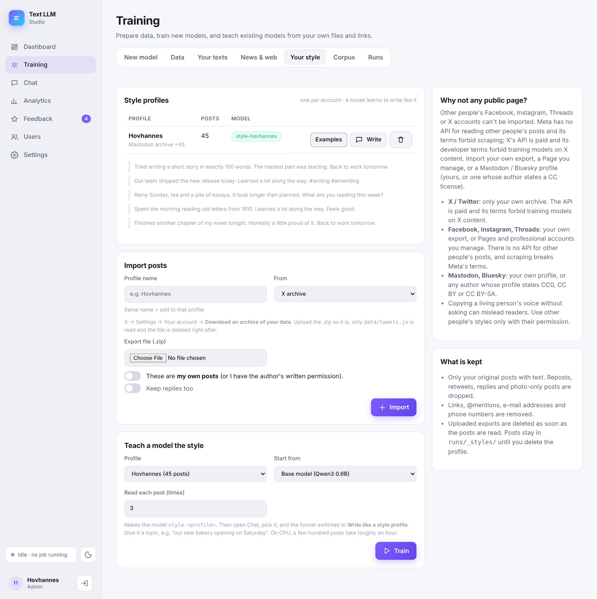

1. **Import posts.** Type a **profile name** (the same name adds to an existing profile) and choose where the posts come from:
   - **X archive:** X → Settings → Your account → Download an archive of your data. Upload the .zip.
   - **Facebook export / Instagram export:** "Download your information", format **JSON**. Upload the .zip.
   - **Mastodon archive:** Preferences → Import and export → Request your archive.
   - **Facebook Page** or **Instagram professional account you manage:** enter the Page or account ID and a Graph API access token (used once, not stored).
   - **Mastodon or Bluesky profile link:** yours, or one whose author states CC0, CC BY or CC BY-SA.

   Tick **These are my own posts** when they are; optionally **keep replies**. Press **Import**. Uploaded files are deleted right after reading; reposts, replies and photo-only posts are dropped; links, @mentions, e-mails and phone numbers are removed.
2. **Teach a model the style.** Choose the profile (it needs at least 30 posts), **Start from** (the base model, or one of your fine-tuned models so it keeps its writing skills) and how many times to **read each post**. Press **Train**. This makes the model `style-<profile>`; a few hundred posts take about an hour on a CPU.
3. **Write.** In the profile table press **Write** (or pick `style-<profile>` in Chat). The format switches to **Write like a style profile**; give it a topic.

**Examples** shows a few imported posts; the trash button deletes the profile (and, if you agree, its model). Other people's Facebook, Instagram, Threads or X accounts can't be imported: there is no API for them and their terms forbid scraping.

# 9. Training: Corpus

Shows what the models learn from: one row per folder under `data/raw/`.

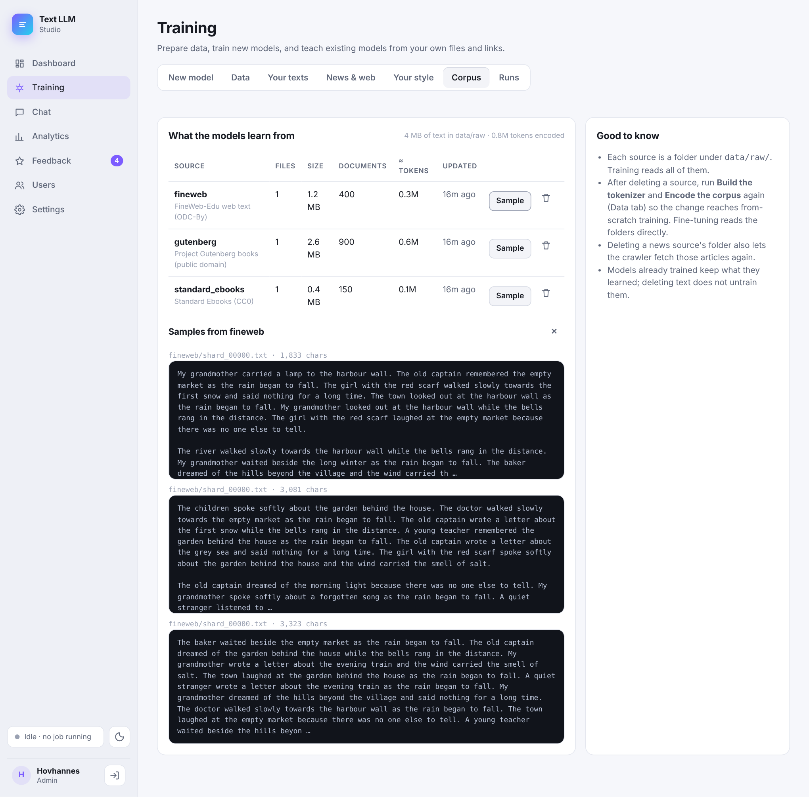

Each row shows files, size, documents, estimated tokens and when it was updated. **Sample** shows three random documents so you can check the quality. The trash button deletes the folder (it asks first and can't be undone).

After deleting a source, run Data step 3 (Encode) again so from-scratch training sees the change. Rebuild the tokenizer (step 2) only before training a new model, never for a model you will resume (see section 5). Fine-tuning reads the folders directly. Models already trained keep what they learned.

# 10. Training: Cluster (several PCs train one model)

Several computers, at home or anywhere on the internet, can train **one** from-scratch model together. Every PC uses what it has: an NVIDIA GPU, an Apple GPU or just the CPU. One PC is the **coordinator**: it holds the prepared data and the model. The others are **workers**.

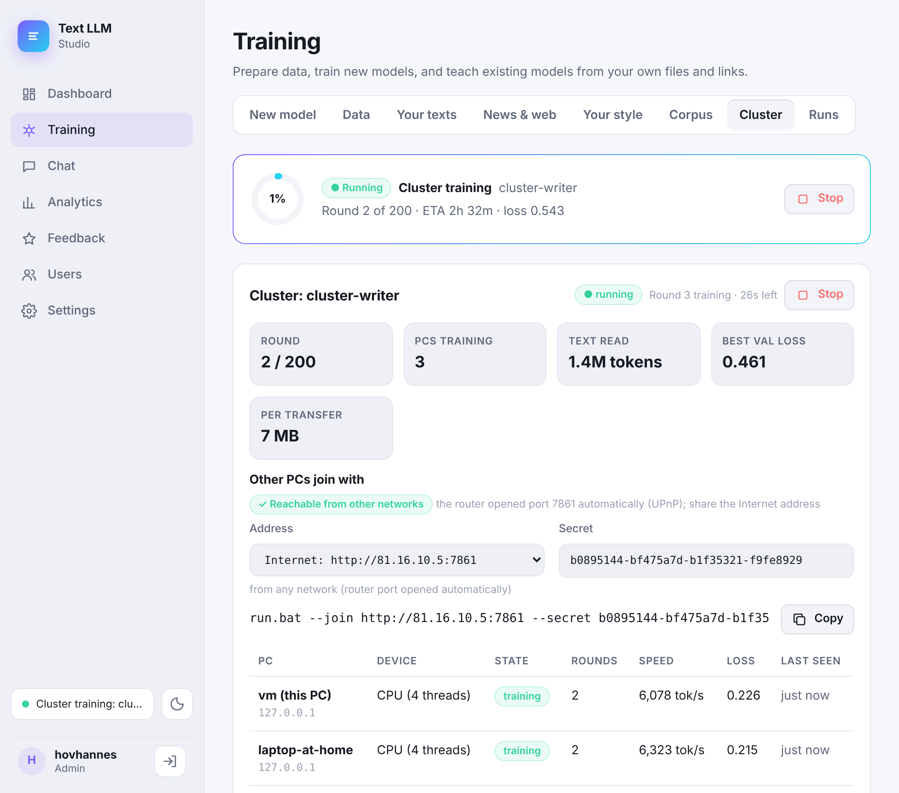

**How it works.** Training goes in rounds (5 minutes by default). At the start of a round every PC holds the same model and trains on its own share of the text for the round's minutes. A GPU simply does more steps than a CPU, and nobody waits for the slowest PC. Then each PC sends how far its copy moved; the coordinator averages the moves (weighted by how much text each PC read) and takes one step with the average. Everyone continues from the result. The internet only carries about one model copy each way per PC per round (CPU size: 28 MB; Small: 220 MB), not data on every step, so a home connection is enough.

**Start a cluster** (on the PC with the data):

1. Run Data steps 1–3 first (section 5).
2. Training → **Cluster** → *Start a cluster on this PC*: name, model size, rounds, minutes per round, learning rate, port (7861). Leave **This PC trains too** on to use this PC as a worker as well, and **Let PCs on other networks join** on if any PC is somewhere else.
3. Press **Start the cluster**. The card at the top shows the addresses and the secret, plus a ready-made command for other PCs, with a **Copy** button. Pick the address the other PC can reach: **Internet** (any network), **Tailscale** (any network, both PCs on Tailscale) or **Same network**.

**Join from another PC:** either open its Studio → Training → Cluster → *Join a cluster*, paste the address and secret, and press **Join**; or, on a PC without the Studio, run `run.bat --join http://ADDRESS:7861 --secret SECRET` (`./run.sh` on Linux/macOS). The first run installs everything, including the GPU build of PyTorch when there is an NVIDIA card. The worker downloads its share of the text once (200 MB by default, resumable), then trains. **Leave** (or Ctrl+C) takes it out; it can rejoin at any time.

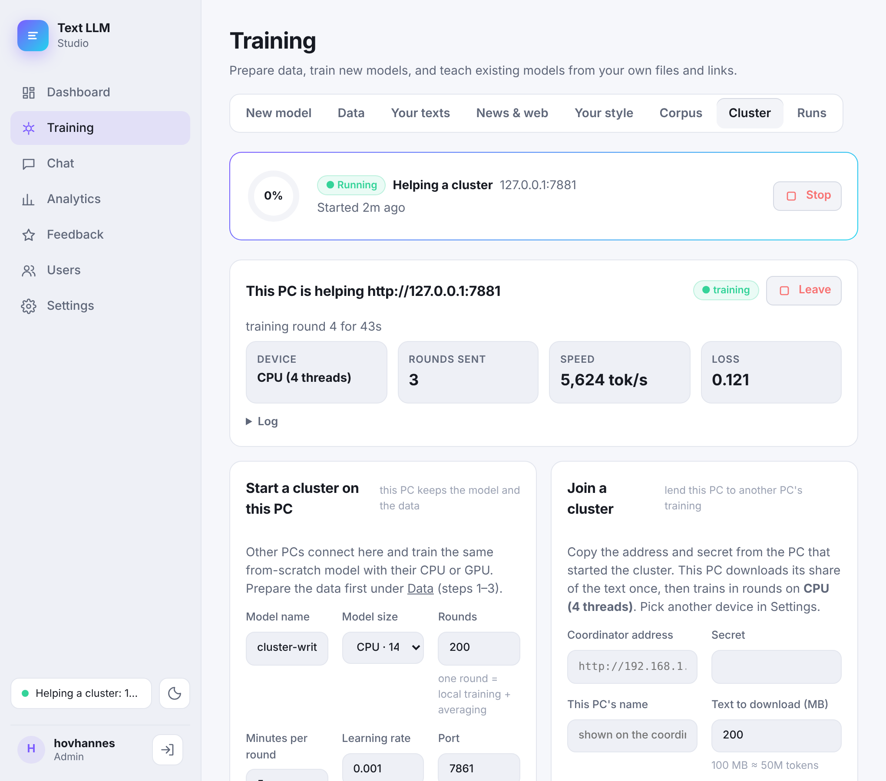

**PCs on other networks.** Only the PC that starts the cluster has to be reachable. The workers only connect out to it, like a browser opening a website, so a worker behind any home router or on mobile internet needs no setup.

- With **Let PCs on other networks join** on, the coordinator asks its router to open the port (UPnP, switched on in most home routers) and closes it again when the cluster stops. When that works the card says **✓ Reachable from other networks** and lists an **Internet** address with your public IP.
- When it says **Same network only**, the router refused or is not the one facing the internet (UPnP switched off, a second router behind the provider's box, or a provider that shares one public address between customers, which is common on mobile internet). Then install the free **Tailscale** on every PC and use the **Tailscale** address, or forward TCP port 7861 to this PC in the router's settings and use your public IP.

The long secret keeps strangers out, but the traffic itself is not encrypted, so Tailscale is the most private choice.

**What speedup to expect.** Roughly 0.6–0.9× each extra PC's own speed: four similar PCs train about 3× faster than one. A GPU worker adds much more than a CPU one. Rounds of 5–10 minutes keep the traffic low; shorter rounds help quality a little but cost more upload.

**Advanced:** secret (made up for you), workers needed before the first round, final learning rate, warmup, weight decay, outer learning rate (0.7) and momentum (0.9), how often to check quality, this PC's batch size, and **Resume** (continue a stopped cluster model from its last round; workers reconnect by themselves). Workers' advanced options: batch size, gradient accumulation, "stop early" seconds for a slow upload, and using the PC's own prepared data instead of downloading (only with the same tokenizer).

The result is an ordinary from-scratch run under Runs: chat with it, export it, or keep training it alone with Resume. Cluster mode is for from-scratch models; fine-tuning (LoRA) still runs on one PC.

# 11. Training: Runs

Every model you train is a **run** in `runs/<name>/`.

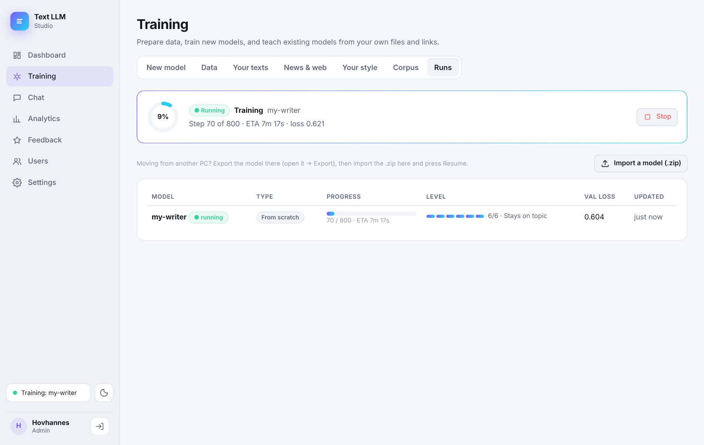

The table shows each run's type, progress bar with step count and ETA, level and validation loss. A running job has a green "● running" tag, and the live card at the top has a **Stop** button. Stopping keeps the last checkpoint.

## Run details

Click a run to open its details. They refresh every few seconds.

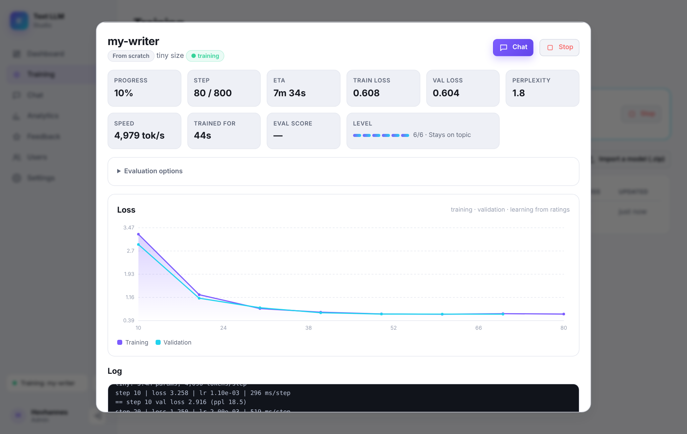

- **Stats:** progress, step, ETA, train and validation loss, perplexity, speed (tokens per second), time trained, evaluation score, and level.
- **Loss chart:** training, validation and learning-from-ratings curves.
- **Log:** the full output of the training script.

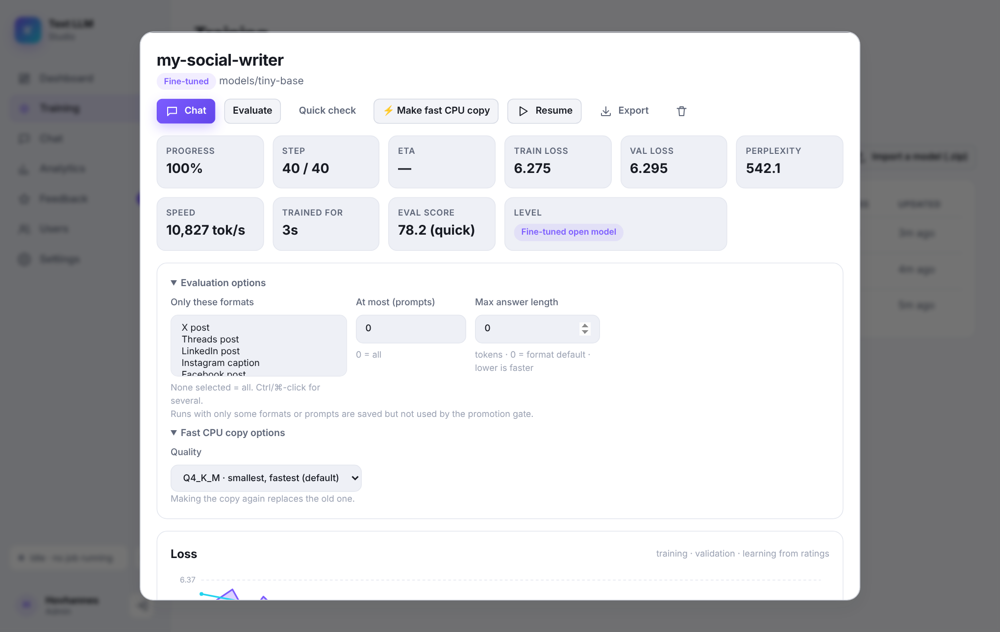

Buttons (which ones appear depends on the run's state):

| Button | What it does |
|---|---|
| **Chat** | open Chat with this model |
| **Evaluate** | score it on the 60 fixed prompts (all formats) |
| **Quick check** | 8 prompts, a few minutes |
| **Make fast CPU copy** | (fine-tuned only) build a 4-bit GGUF file; chat then uses it |
| **Stop** | stop the running job; the last checkpoint is kept |
| **Resume** | continue training from the last checkpoint with the run's own settings |
| **Export** | download the run as a `.zip` (from-scratch: OK = include the training data) |
| 🗑 | delete the run and its weights |

**Evaluation options:** only some formats, at most N prompts, maximum answer length. Partial evaluations are saved but not used when deciding the default model. **Fast CPU copy options:** quality Q4_K_M (smallest, fastest, default), Q5_K_M, Q6_K or Q8_0 (bigger, closer to the original).

## Move a model to another PC

1. On the old PC open the model, press **Stop** if it is training, then **Export**.
2. On the new PC run `run.bat` once, go to Training → Runs and press **Import a model (.zip)** at the top right. If a model with that name exists you can give a new name or replace it.
3. Open the imported model and press **Resume**.

This works between Windows and Linux, and between GPU and CPU computers. A fine-tuned model's base model (for example Qwen3 0.6B) is not inside the zip; the new PC downloads it once.

# 12. Chat

Chat is where you (and regular users) write with the models.

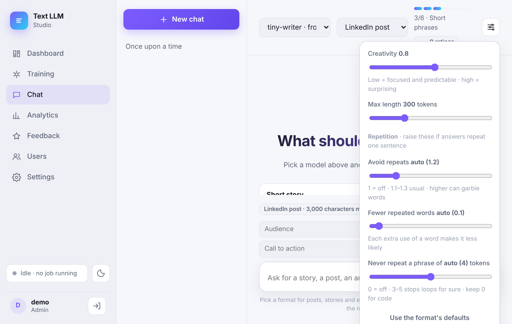

- **Left:** your conversations. **New chat** starts a fresh one; the ✕ deletes one.
- **Model picker:** every trained model with its type ("from scratch", "fine-tuned", "writes like …") and which one is the **default**. Next to it you see the model's level and average rating.
- **Format picker:** Free chat; posts (X post, Threads post, LinkedIn post, Instagram caption, Facebook post); About today's news; Short story; Essay; Write like a style profile. Each format has its own instructions, length limit and a small form (tone, audience, takeaway, hashtags, length…) shown above the message box.
- **Settings button** (sliders icon): **Creativity** (low = focused, high = surprising) and **Max length** in tokens. *Use the format's defaults* resets both.
- The welcome screen has example prompts; click one to try it.

Press **Enter** to send, **Shift+Enter** for a new line. The answer streams in. Stories and essays are planned first; the plan appears in a **Plan** box above the answer. Posts are checked automatically (length limit, hashtags, hook, closing question) and rewritten up to 3 times if they fail.

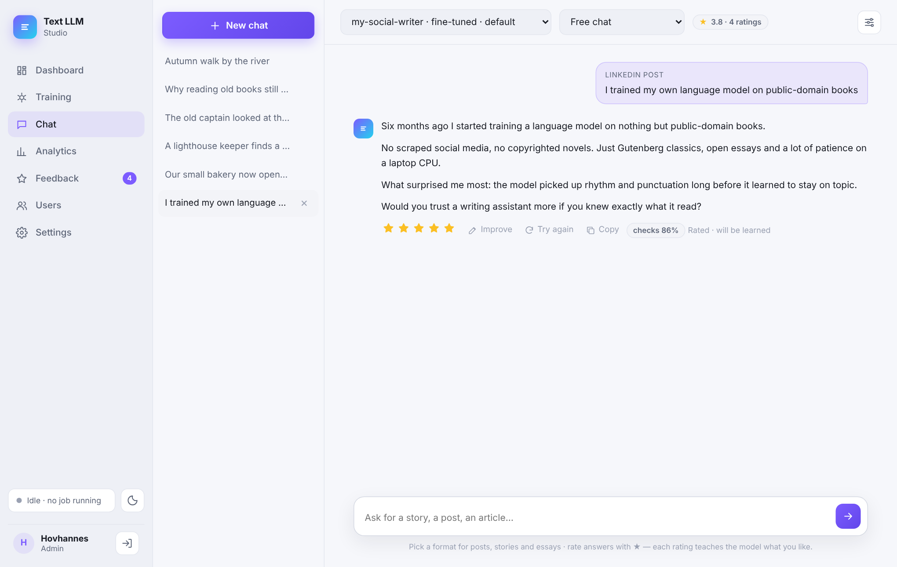

Under every answer:

- **★ 1–5:** rate it. Each rating teaches the model what you like. A rating of 1–2 opens the *Improve* box.
- **Improve:** write or paste the answer you wanted, optionally say what was wrong, and press **Save & teach**. The model learns from your corrected answer.
- **Try again:** writes another answer to the same request ("Answer 2 of 2").
- **Copy:** copies the text.
- **checks N%:** the automatic format checks (green = all passed).
- A status: "Rated · will be learned", "✓ learned", or "held back by the quality gate".

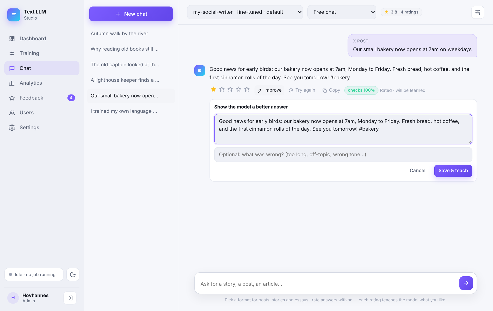

With **About today's news**, the answer lists the articles it is based on, with links.

# 13. Analytics

Admins see how the models learn and how people rate them.

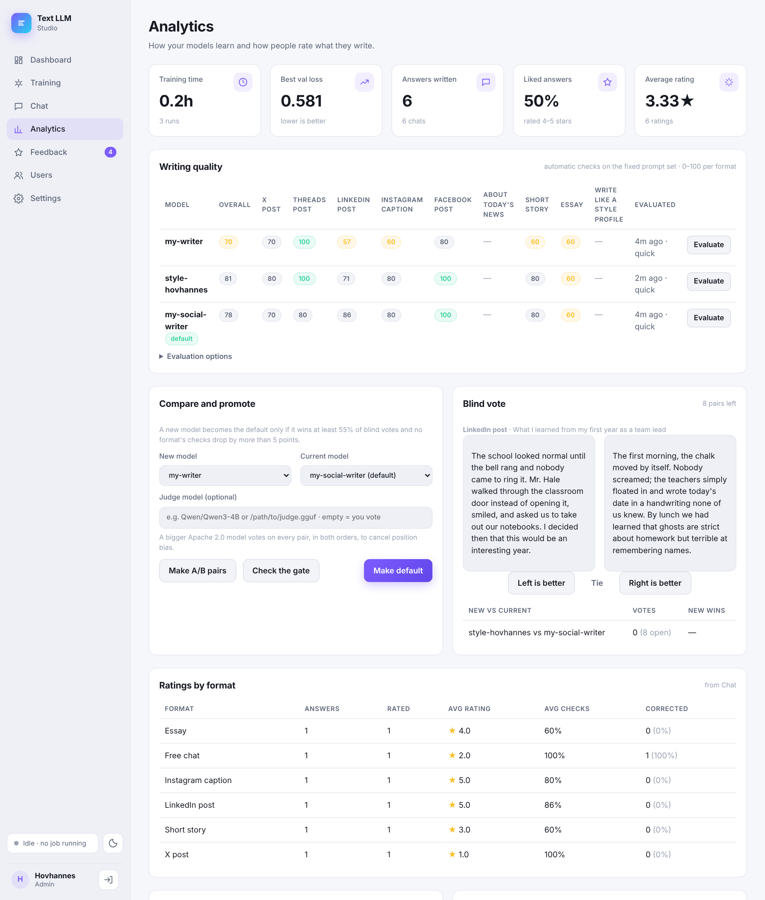

- **KPIs:** total training time, best validation loss, answers written, share of liked answers (4–5★), average rating.
- **Writing quality:** the automatic-check score (0–100) of every model overall and per format, from its latest evaluation, with **Evaluate** and **Quick** buttons. The default model is marked *default*; ⚡ *fast* means chat uses the GGUF copy.
- **Compare and promote:** pick a **new model** and the **current model**. **Make A/B pairs** has both write answers to the same prompts. Optionally name a bigger **judge model** that votes on every pair. **Check the gate** tells you whether the new model may become the default, and **Make default** promotes it. A model becomes the default only if it wins at least 55% of at least 10 blind votes and no format's checks drop by more than 5 points.
- **Blind vote:** two answers to the same prompt, without model names. Choose **Left is better**, **Tie** or **Right is better**. The table below counts votes and wins.

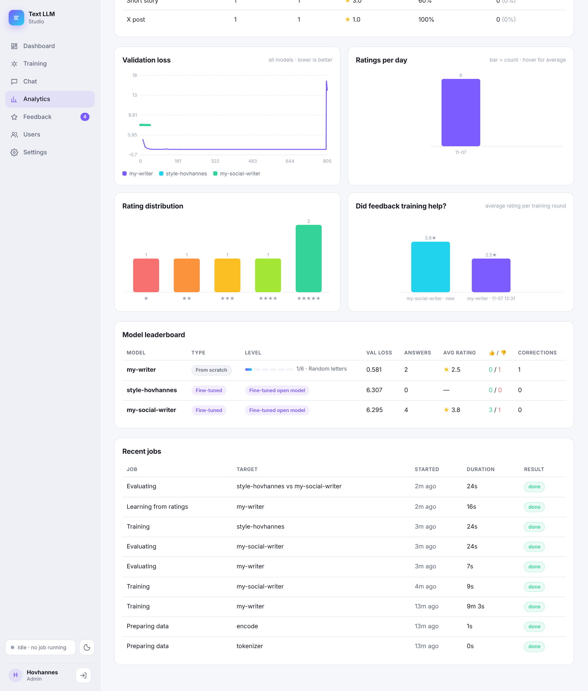

Further down: **ratings by format**, **validation loss** for all models, **ratings per day**, **rating distribution**, **Did feedback training help?** (average rating per training round), the **model leaderboard** (click a model to open its details) and **recent jobs** with their result.

# 14. Feedback

Every rating and correction becomes training data. Liked answers and corrections teach the model what to write; disliked answers teach it what to avoid.

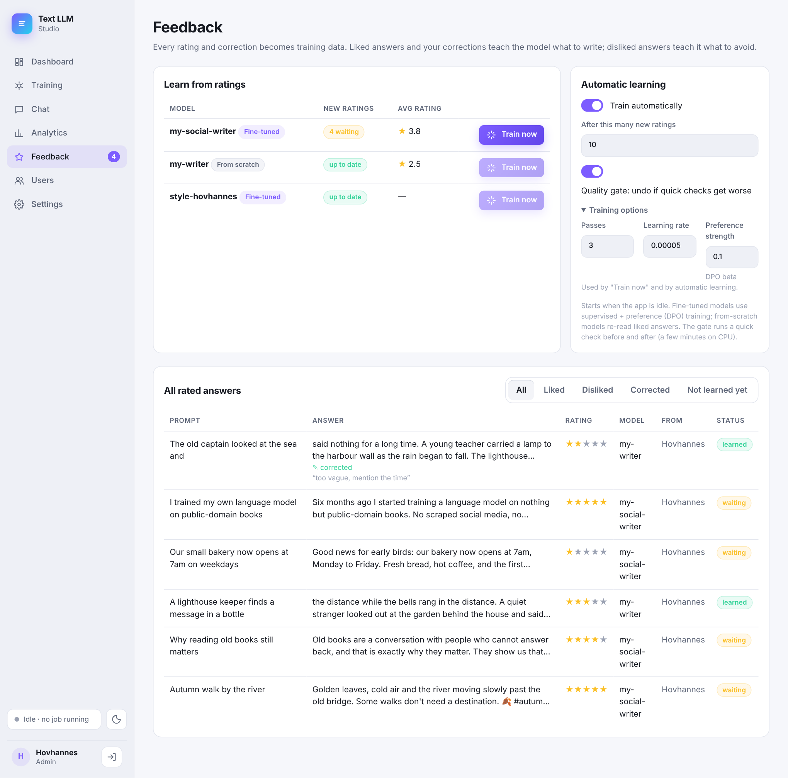

- **Learn from ratings:** one row per model with the number of ratings waiting, its average rating and **Train now**.
- **Automatic learning:** *Train automatically* after N new ratings (default 10), and the **quality gate**: a quick check before and after, and the learning is undone if the checks get worse.
- **Training options:** passes, learning rate and preference strength (DPO beta). Used by *Train now* and by automatic learning.
- **All rated answers:** filter by All, Liked, Disliked, Corrected or Not learned yet. Each row shows the prompt, the answer (✎ corrected, your comment), rating, model and status: *waiting*, *learned* or *held back*. Click a row to open that conversation.

How the learning works: fine-tuned models train on liked and corrected answers directly and use a DPO preference loss when a liked or corrected answer can be paired with a disliked one. From-scratch models re-read the prompts with their liked answers. Feedback that was used is marked *learned* and is not trained on again.

# 15. Users

Admins add people and set their role.

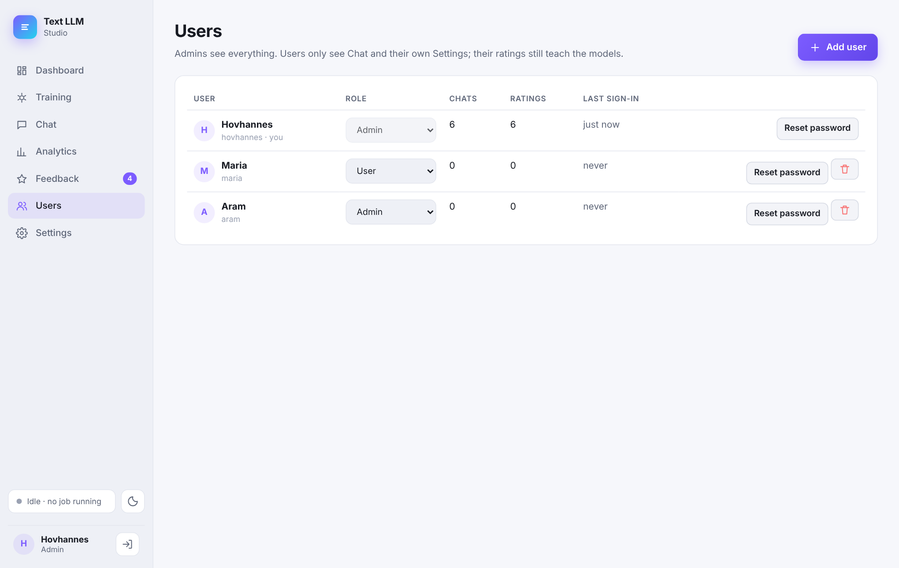

Each row shows the person, their role (change it in the drop-down; you can't change your own), how many chats and ratings they have, their last sign-in and **Reset password**. The trash button removes an account (you cannot remove yourself).

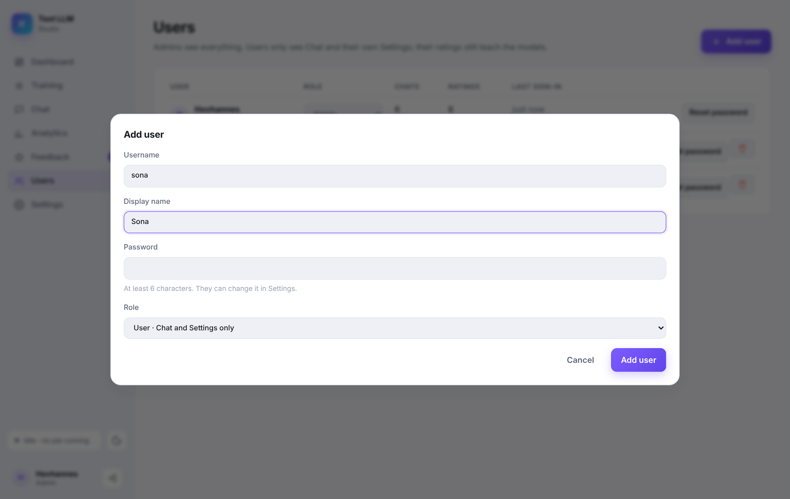

**Add user** asks for a username, an optional display name, a password (at least 6 characters; they can change it later) and the role: **User** (Chat and Settings only) or **Admin** (everything).

# 16. Settings and hardware

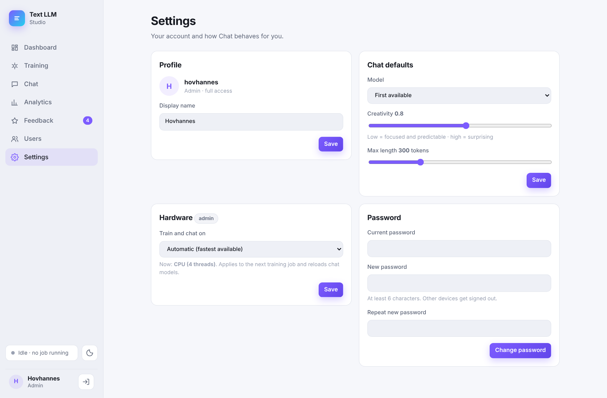

- **Profile:** your display name.
- **Chat defaults:** the model Chat opens with, creativity and maximum length.
- **Password:** current password and a new one twice. Other devices get signed out.
- **Hardware** (admins only): **Train and chat on** automatic, CPU, or a specific GPU. It applies to the next training job and reloads chat models. If you have an NVIDIA card but only the CPU build of PyTorch is installed, the hint tells you to close the Studio and run `run.bat --gpu`.

# 17. Command-line equivalents

Everything in this manual can also be done from a terminal in the project folder (activate `.venv` first). The most useful commands:

```
python -m studio.auth add alice --admin     # add an admin (asks for a password)
python -m studio.auth add bob               # add a regular user
python -m studio.auth passwd bob            # new password
python data/build_corpus.py --gutenberg-max 3000 --fineweb-gb 0.3
python tokenizer/train_tokenizer.py --raw data/raw --vocab 8192 --out tokenizer/bpe.json
python tokenizer/train_tokenizer.py --encode --raw data/raw --tok tokenizer/bpe.json --bin data/bin
python train.py --preset cpu --vocab 8192 --max-steps 20000 [--resume]
python finetune/finetune_lora.py --base Qwen/Qwen3-0.6B --out runs/my-social-writer --gguf
python learn.py --run runs/my-writer --files book.pdf --urls https://example.com/article
python data/crawl.py --learn runs/my-model
python data/own_posts.py --profile me --name "Me" --x-archive twitter.zip --i-own-these
python evaluate.py --run runs/my-social-writer --quick
python transfer.py export --run runs/my-model --with-data
python transfer.py import my-model.textllm.zip
python cluster.py coordinator --out runs/cluster-writer --preset cpu --vocab 8192 --local-worker
python cluster.py worker --join http://ADDRESS:7861 --secret SECRET    # or: run.bat --join ... --secret ...
```

See README.md for every option.

# 18. Troubleshooting

| Problem | What to do |
|---|---|
| The browser doesn't open | Open http://127.0.0.1:7860 yourself (or the port printed in the window). |
| Forgot the admin password | Stop the Studio and run `python -m studio.auth passwd <name>`. |
| Download keeps disconnecting (`WinError 10054`) | Press **Run** again; every source resumes. Under *Downloading* choose "Download whole files first" and more retries. |
| "Prepare the training data first" | Run Data steps 1–3 before training from scratch. |
| Resumed model writes nonsense after a corpus change | The tokenizer was rebuilt. Restore the old one (each run keeps a copy as `runs/<name>/tokenizer.json`; copy it to `tokenizer/bpe.json`) and run Data step 3 again. |
| The GPU isn't used | Update the NVIDIA driver, then `run.bat --reinstall` (or `--gpu`). Check Settings → Hardware. On laptops, plug in the charger and set Windows Graphics to "High performance" for Python. |
| "CUDA out of memory" | Halve the batch size and double the gradient accumulation. |
| A PDF gives no text | It's a scan: run OCR (`ocrmypdf`) first. |
| A news source is "skipped until you confirm the rights" | Its license is copyrighted/unknown: tick that you have permission, or remove it. |
| Chat is slow with a fine-tuned model | Open the run and press **Make fast CPU copy**. |
| A worker keeps saying "coordinator not reachable" | Check the address and port, and that the coordinator's firewall allows port 7861 (Windows asks once; allow it on private and public networks). From another network use the Internet address only when the card says "Reachable from other networks"; otherwise use Tailscale. The worker retries by itself. |
| "403 wrong secret" when joining | Copy the secret again from the coordinator's Cluster page; a new secret is made each time a cluster starts unless you set one. |
| Learning from news or ratings was "undone" | The quality gate saw the quick-check score drop; the previous model was kept. |

Only use texts you have the right to use. This project trains on public-domain and openly licensed text, plus your own writing.
